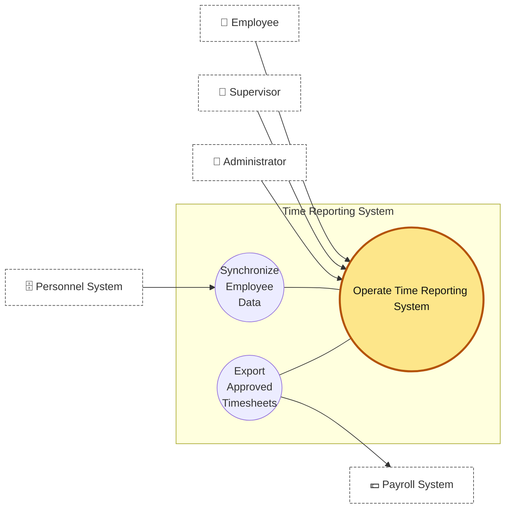
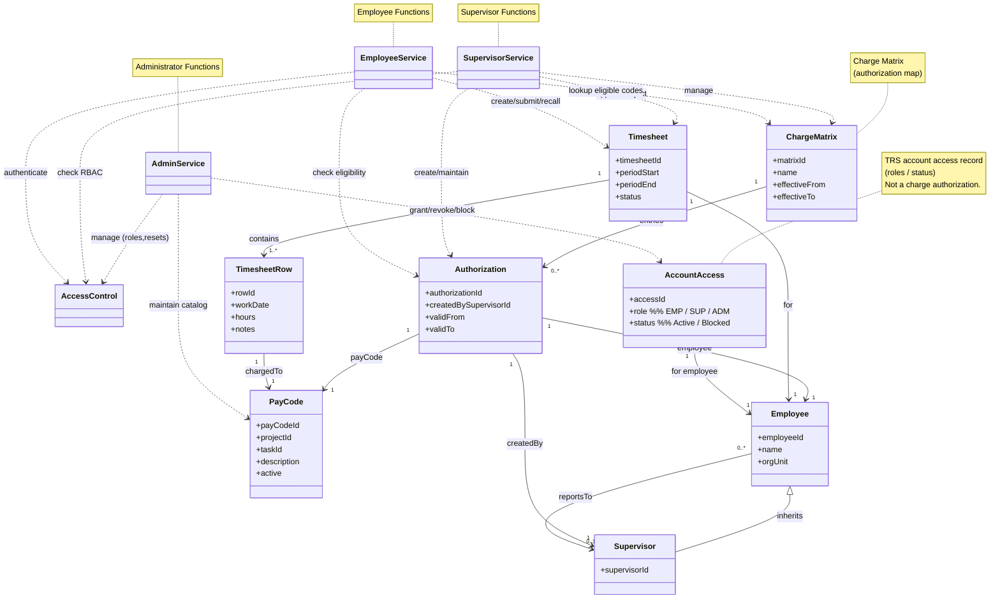
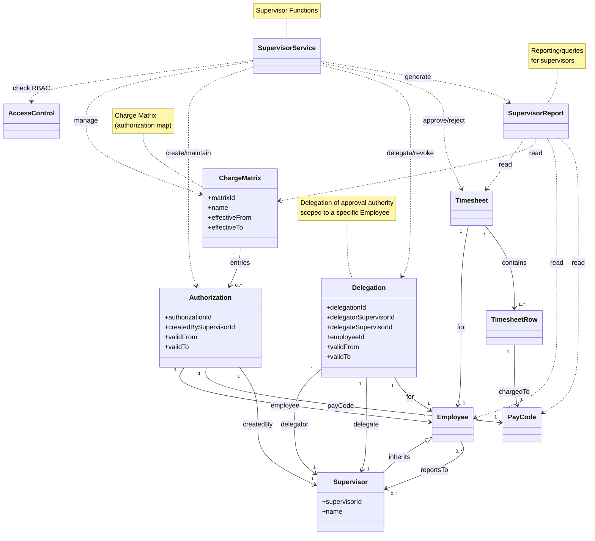
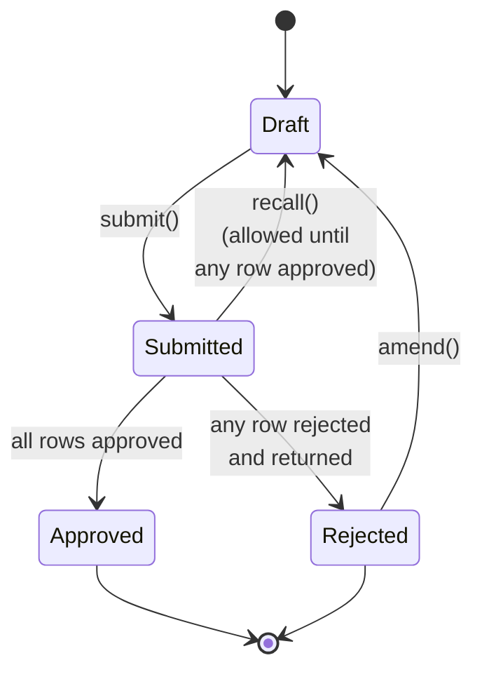
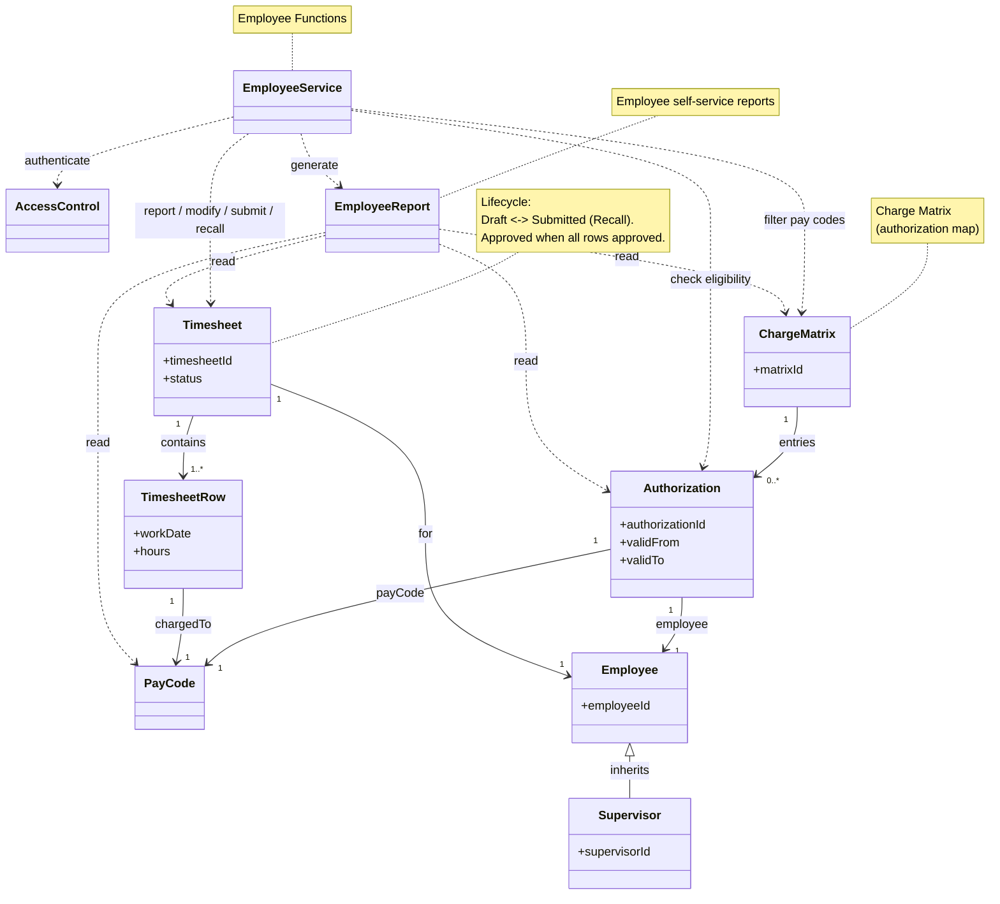
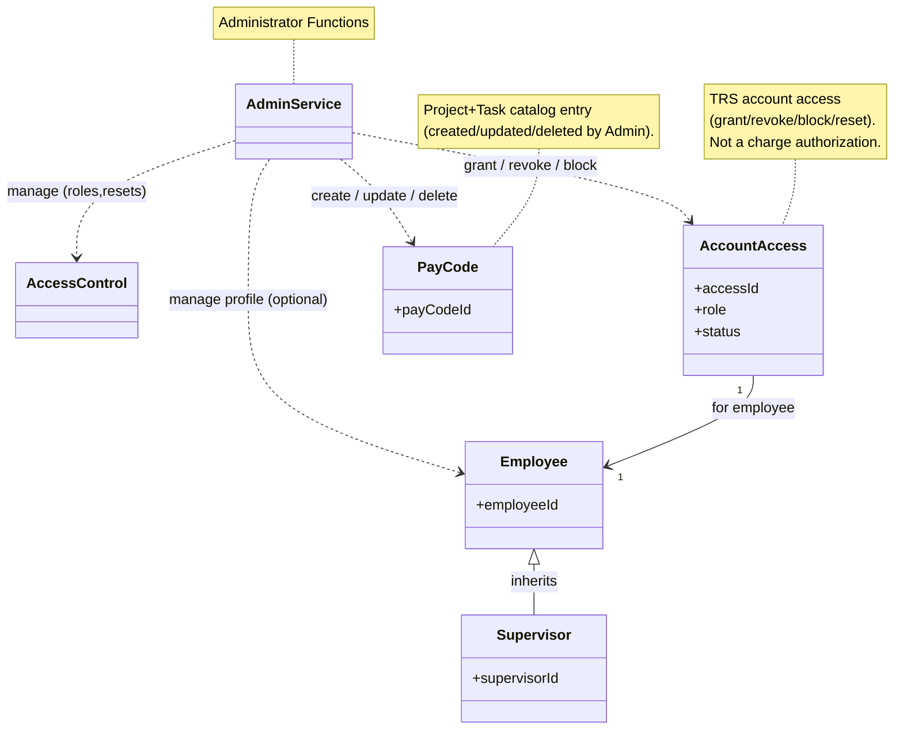

# Time Reporting System — System Description

## 1) Overall Context

The **Time Reporting System (TRS)** lets employees report hours worked against customer projects so customers can be billed. Hours are charged to **Pay Codes** (each Pay Code = unique _project + task_). Employees may only charge to Pay Codes for which they have a **charge authorization**.

Because many employees work at customer sites, TRS must support **remote access via web** with no local installs, and run seamlessly on **Chrome, Safari, and Firefox**.

To reduce misuse or tampering, access is **password-protected** and **Pay Code creation is separated from charge authorization**. Worked hours can be approved **only** by the supervisor who **created** the relevant authorization **or their delegate** (delegation is scoped to a specific employee). A supervisor **cannot authorize themself** to charge to a Pay Code.

Approved timesheets are exported to the **Payroll System**, which the organization uses for payroll and **downstream billing**.

---

## 2) System Context

**Purpose & scope.** The diagram shows the **TRS boundary**, the **human actors**, and the **two system-to-system interfaces**.

### 2.1 UML Use Case Diagram

### 2.2 Actors at the boundary

- **Employee** — performs day-to-day time reporting.
    
- **Supervisor** — creates charge authorizations, delegates approval, and approves timesheets.
    
- **Administrator** — manages account access and the Pay Code catalog.
    
- **Personnel System (Perso)** — inbound HR/master data for employees and reporting lines.
    
- **Payroll System** — receives **approved** timesheets for payroll and downstream billing.
    

### 2.3 Information flow & boundary rules

- Direction on arrows indicates who initiates and where data goes (e.g., **Perso → TRS**; **TRS → Payroll**).
    
- Context-level only: internals (DB, screens, services) are out of scope here.
    

---

## 3) Time Reporting Subsystems

- **Access Control** — login and RBAC; **Admin maintains**, **Supervisor/Employee consume**.
    
- **Pay Code** — catalog of chargeable codes (project+task); **Admin maintains**.
    
- **Employee** — employee reference data (incl. supervisor reporting line from Perso).
    
- **Charge Matrix** — the **authorization map** (which employees may charge which Pay Codes); **Supervisors own** it.
    
- **Timesheet** — employees enter/submit; supervisors approve/reject according to the Charge Matrix rules.
    

### 3.1 Operational story

1. **Admins** maintain Access Control and the Pay Code catalog.
    
2. **Supervisors** build the Charge Matrix (authorizations) and approve Timesheets they own (or via valid delegation).
    
3. **Employees** authenticate, see **only authorized** Pay Codes, and create/submit Timesheets.
    

### 3.2 Global UML Class Diagram

---

## 4) Supervisor Functions

- **Login → Access Control** — RBAC is checked for supervisor capabilities.
    
- **Create/Delete Charge Authorization** — grants/removes an employee’s ability to charge a Pay Code (project+task). The record is stored in the **Charge Matrix** and marked with **createdBy** (the owning supervisor).
    
- **Delegate Approval / Revoke Delegation** — a supervisor may delegate **approval authority for a specific employee** to another supervisor for a validity window.
    
- **Approve Timesheet** — approves/rejects employee Timesheets. Approval is allowed when the approver is **the Authorization.createdBy** **or** has a **valid Delegation** for that **employee**.
    
- **Supervisor Report** — reports over authorizations and Timesheet status/activity.
    

### 4.1 Supervisor UML Class Diagram

**Approval policy for mixed Pay Codes.** Approvals are **per TimesheetRow** (per charged Pay Code). A Timesheet becomes **Approved** when **all** rows are approved; otherwise it remains **Partially Approved** or **Submitted** (policy name up to the team).

---

## 5) Employee Functions

- **Login → Access Control** — the employee authenticates.
    
- **Report Time** — create time entries (date, Pay Code, hours, notes).
    
- **Modify Timesheet** — edit Draft entries.
    
- **Submit Timesheet** — move to **Submitted** for supervisor action (usually locks edits).
    
- **Recall Timesheet** — move back to **Draft** (allowed **until any row is approved**).
    
- **Employee Report** — personal summaries (hours by period/Pay Code, statuses).
    

### 5.1 Operational story

1. Employee authenticates.
    
2. Employee records time, with available Pay Codes filtered by the **Charge Matrix** (must be authorized).
    
3. Employee can modify until submission; after submission, they can **recall** (unless any row was already approved).
    
4. Employee may view reports at any time.
    

### 5.2 Timesheet lifecycle (policy)

### 5.3 Employee UML Class Diagram

---

## 6) Administrator Functions

Two areas, both gated by Login/Access Control:

1. **Employee account & access management**
    
    - **Grant TRS Account Access** (provision/activate account with role).
        
    - **Revoke TRS Account Access** (permanently remove access).
        
    - **Block Account** (temporary disable).
        
    - **Reset Password**.
        
2. **Pay Code catalog lifecycle**
    
    - **Create / Update / Delete Pay Code** entries used by other subsystems.
        

> Terminology: These are **account access** operations (not charge authorizations). Charge authorizations are in the Supervisor area via the **Charge Matrix**.

### 6.1 Admin UML Class Diagram

---

## 7) The contract

Your company bids for a **turnkey** contract: it builds TRS, deploys it, and supports it after
launch. The client is a large consulting firm with **four offices** across the country. TRS
replaces the firm's existing **mainframe** time reporting application.

The contract obliges your company to deliver:

- a **specification** with wireframes and navigation diagrams, approved by the client;
- the software, in **three increments**, each one demonstrated to the client;
- the **data migration**: the client's IT department sends the old data as CSV files **one week
  before launch**, and your company loads them;
- the **training material**: the client's HR department runs the training, and needs the material
  **two weeks before** the training session;
- the **acceptance test procedure**: the client's IT department runs acceptance, and needs the
  procedure **at least one week before** the test;
- **30 days of support** after deployment.

### 7.1 Payment schedule

| # | Milestone | Payment |
|---|---|---|
| 1 | Specification approved, including wireframes and navigation diagrams | 5% |
| 2 | Data migrated from the old system to the new one | 5% |
| 3 | Each increment demonstrated (three in total) | 20% each |
| 4 | User training completed | 10% |
| 5 | System accepted | 10% |
| 6 | 30-day post-deployment support period completed | 10% |

---

## 8) Function list

The names used in C4, C5 and C6. Twenty-two functions: nineteen the client ranks in C6, plus
two system interfaces and the data load.

| # | Function | Actor | Section |
|---|---|---|---|
| 1 | Login | all users | §3, §5 |
| 2 | Grant Account Access | Administrator | §6 |
| 3 | Revoke Account Access | Administrator | §6 |
| 4 | Block Account | Administrator | §6 |
| 5 | Reset Password | Administrator | §6 |
| 6 | Create Pay Code | Administrator | §6 |
| 7 | Update Pay Code | Administrator | §6 |
| 8 | Delete Pay Code | Administrator | §6 |
| 9 | Create Charge Authorization | Supervisor | §4 |
| 10 | Delete Charge Authorization | Supervisor | §4 |
| 11 | Delegate Approval | Supervisor | §4 |
| 12 | Revoke Delegation | Supervisor | §4 |
| 13 | Approve Time Sheet | Supervisor | §4 |
| 14 | Supervisor Report | Supervisor | §4 |
| 15 | Report Time | Employee | §5 |
| 16 | Modify Time Sheet | Employee | §5 |
| 17 | Submit Time Sheet | Employee | §5 |
| 18 | Recall Time Sheet | Employee | §5 |
| 19 | Employee Report | Employee | §5 |
| 20 | Synchronize Employee Data | Personnel System | §2 |
| 21 | Export Approved Time Sheets | Payroll System | §2 |
| 22 | Import Legacy Data | client IT (CSV) | §7 |

*Grant / Revoke Account Access* and *Block Account* are account operations. They are **not**
charge authorizations (see the note in §6).

---

## 9) After the contract is won (C5, C6)

- **Team:** two developers and one tester, 40 hours a week each. A working day is 8 hours,
  Monday to Friday. Ignore public holidays. You are the project manager; your hours are not in
  the team's.
- **Kick-off:** Monday 11 January 2027.
- **Development starts:** Monday 1 February 2027, after the specification is approved.
- **Operational deadline:** TRS is live no later than Tuesday 1 June 2027.

---

## Acknowledgments

The Time Reporting System, its description and the three assignments are adapted from
**Eduardo Miranda**'s course material on estimating and planning software projects (TRS
description 2009; critical-path and milestone assignments 2013), taught with **David Root**.

## Sources

- Miranda, Eduardo. *Time Reporting System — System Description.* Course material, 2009.
- Miranda, Eduardo. *Critical Path* and *Developing a Milestone Plan.* Assignments, 2013.
- Miranda, Eduardo. "Time-boxing planning: Buffered MoSCoW rules." *ACM SIGSOFT Software
  Engineering Notes* 36(6), 2011, 1–5.

---

{: .highlight }
**Disclaimer:** AI is used for text summarization, polishing and explaining. Authors have verified all facts and claims. In case of an error, feel free to file an issue.
