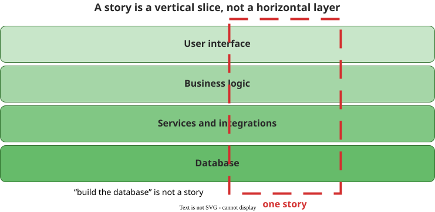

# Documenting Requirements

A requirements document records the agreement about what will be built, in a form that can be
reviewed, tested against and traced. Which document depends on who must act on it.

## 1. The artefacts, and what each one is for

| Artefact | What it settles | Example |
|---|---|---|
| **Statement of work** | Who does what, by when, for what payment, and how change is authorised | *"Prototype by 30 June; payment 30% at prototype, 50% at beta, 20% on acceptance."* |
| **Requirements specification** | The properties the product must exhibit, with constraints and interfaces | *"Search returns results within 200 ms at the 95th percentile."* |
| **Concept of operations** | How the system will be used in its real environment | *"Used from school devices 08:00–16:00; on network loss it degrades to read-only."* |
| **Acceptance criteria** | What "done" means for one feature | *"The reset link expires in 30 minutes and the user is notified of a successful reset."* |
| **Epics and user stories** | A unit of work, and a promise to talk | *"As a registered user, I want to reset my password by email link so that I can regain access."* |

## 2. What a specification contains

A requirements specification has a standard shape, and ISO/IEC/IEEE 29148 is the current source for
it  (IEEE 830, withdrawn in 2011, had the same outline). The sections follow
from what the document has to enable: estimation, design, testing and acceptance.

| Section | What goes there |
|---|---|
| **Purpose and scope** | The problem, and what is in and out |
| **Stakeholders and users** | Who needs it and who uses it |
| **Functional requirements** | What it does, in the shape from [requirement statements](stmts) |
| **Quality requirements** | How well, as quality-attribute scenarios |
| **Constraints and interfaces** | Decisions already taken, and what the system connects to |
| **Verification** | How each requirement will be checked |
| **Glossary** | The customer's words, defined |

Schedule, cost and team belong in the plan: *"The SRS should address the software product, not the
process of producing the software product."* An empty section is a question nobody has asked yet.

## 3. A story card is deliberately thin

A user story has *"three components: Cards (their physical medium), Conversation (the discussion
surrounding them), and Confirmation (tests that verify them)"* .
The card is a token for the conversation, not a substitute: Wake calls the story a **pidgin
language** .

_A story is a vertical slice, not a layer._ 

**INVEST** is the usual check: **I**ndependent, **N**egotiable, **V**aluable, **E**stimable,
**S**mall, **T**estable. *Testable* carries the most teaching: *"writing a story card carries an
implicit promise: 'I understand what I want well enough that I could write a test for it.'"* Ask the
customer how they would test the story. INVEST says nothing about the *set*: six perfect cards can
still duplicate each other and leave a gap.

## 4. Six properties of a card, four of a backlog

The Quality User Story framework gives thirteen criteria , and the split
that matters is **where each can be checked**:

- **On one card:** well-formed, atomic, minimal, conceptually sound, **problem-oriented** (*"only
  specifies the problem, not the solution to it"*), unambiguous, full sentence, estimatable.
- **Only across the backlog:** unique, conflict-free, uniform, complete.

That is the same statement-level/document-level split that [requirement statements](stmts) makes for
an SRS. The most common substantive defect is *problem-oriented* failing — a story that specifies
the solution.

## 5. Slice vertically, and gate on readiness

Splitting a story means cutting **vertically through the layers** — network, persistence, logic,
presentation — so the customer gets *"the essence of the whole cake"* . A
sprint that finishes "the database" and demos nothing has sliced horizontally.

Acceptance criteria are where the agreement becomes checkable, usually in **Given–When–Then** form
. For example, *given I am logged in, when I click Save, then the
item appears in my wishlist.* And a **Definition of Ready** gates entry to a sprint as a Definition
of Done gates exit  — business goal, expected outcome, enough detail to
estimate.

Non-functional requirements are what agile documentation most often loses, since they belong to no
single story . They need a deliberate home: a definition of done, a
quality scenario, or the specification.

## 6. What documentation does not do

A document records an agreement; it does not create one. Whether the thing is worth building
belongs to [elicitation](elicitation) and [validation](eng).

## How solid is this?

- **Where it comes from.** Two practitioner articles (the 3Cs, INVEST) reporting no study, one
  empirical paper on **1,023 user stories from 18 companies**, and a textbook.
- **What is contested.** Nothing tests whether user stories produce better outcomes than a
  specification; the defensible position is that the *form* should not be discernible downstream.
- **What we do not hold.** The user-story corpus is 17 Dutch vendors and one Brazilian — a narrow
  base for claims about processing English-language requirements.

---

### Acknowledgments

This page adapts material from lectures by Eduardo Miranda and David Root
 on software project management.

### References



---

{: .highlight }
**Disclaimer:** AI is used for text summarization, polishing and explaining. Authors have verified all facts and claims. In case of an error, feel free to file an issue.
