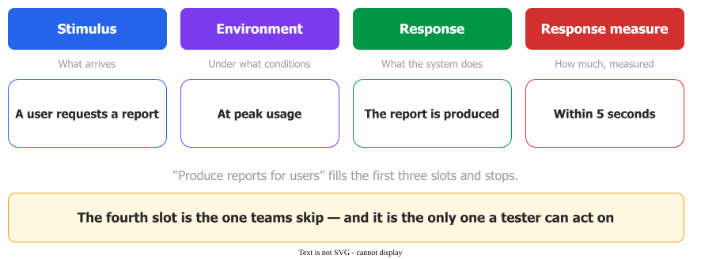

# Requirement Statements

A requirement statement is a single sentence asserting one property the system must exhibit, written
so that someone can check whether it holds. Most of the craft is in that last clause: **if you
cannot describe how you would check it, it is not a requirement yet.**

## 1. Classify by concern, not by wording

The rule usually taught — *what* the system does is functional, *how* it behaves is non-functional —
breaks as soon as the sentence is rephrased. Glinz shows this with one security requirement written
three ways :

| Wording | The old rule says |
|---|---|
| *"The system shall prevent any unauthorized access to the customer data"* | non-functional |
| *"The probability for successful access … shall be smaller than 10⁻⁵"* | non-functional |
| *"The database shall grant access to the customer data only to those users that have been authorized by their user name and password"* | **functional** |

Same requirement, three sentences, two answers: *"the kind of a requirement depends on the way we
represent it."* The repair is to ask what the requirement was stated **for**, taking the first yes:
behaviour or data, regardless of how it is done, is **functional**; a limit on timing, volume or
throughput is **performance**; a particular quality is a **quality requirement**; anything else is a
**constraint**. Performance gets its own box because time and volume have agreed measures and no
other quality does, so elsewhere **agreeing the measure is part of the work**.

## 2. A quality attribute qualifies a function; it is not a parallel list

Learning two columns, functions on the left and "ilities" on the right, is how this goes wrong: a
quality requirement has no meaning except as a qualifier of some behaviour .

For example, *"the system shall produce reports for users"* becomes
:

> A remote user requests a database report via the Web during peak usage and receives the report
> within five seconds.

The scenario has four slots, **stimulus, environment, response, response measure**, and the fourth
turns an aspiration into a requirement; the original function is not lost, it is qualified.
*Modifiable* means nothing until it reads *"in less than two person-weeks"*.

## 3. Six things you can check on a sentence, four only on a document

Wiegers separates the two levels; a review checking all ten against every sentence is doing the
wrong work twice .

_The fourth slot is the one teams skip._ 

**On one statement:** correct · feasible · necessary · prioritised · **unambiguous** (*"the reader
should be able to draw only one interpretation of it"*) · **verifiable**.

**On the whole document:** complete · consistent · modifiable · traceable.

One check is cheap enough to use every time, the **"call me when you're done" test**: read the
requirement from the developer's side, mentally add that phrase, and notice whether it makes you
nervous. Wiegers also gives a closed list of words to avoid: *user-friendly, easy, simple, rapid,
efficient, several, state-of-the-art, improved, maximize, minimize, quick, if possible*, plus
*support*, since *"any requirement that says the product shall 'support' something is not
verifiable."*

## 4. One shape for every sentence

ISO/IEC/IEEE 29148 gives a requirement sentence five slots :
**[condition] the [subject] shall [action] the [object] [constraint of action]**. The standard's
own example is *"Upon receiving signal x, the system shall set the 'signal x received' bit within 2
seconds."* The condition slot may be empty for a requirement that always holds; the constraint slot
is where a quality attaches to its function.

A fixed shape makes a missing slot visible before any reviewer reads the sentence. Three writing
rules go with it : one requirement per sentence, always *shall* with
priority in a separate field rather than in *should* or *may*, and never *and/or*.

## 5. The limits

None of this makes a requirement set correct. Wiegers is blunt: *"there is no formulaic way to write
excellent requirements. It is largely a matter of experience."* The characteristics are a review
aid, not a gate to pass at 100%. And a **qualitative** requirement has no direct verification at
all, only judgement, a prototype or a proxy metric, which is the principled reason *"the system
shall be user-friendly"* is not a requirement.

## How solid is this?

- **Where it comes from.** A terminology paper, an SEI method description and a practitioner
  article. None reports a study or a measurement; they establish definition, classification and
  method, which is a different kind of claim from a measured finding.
- **What is contested.** Glinz's vocabulary is a **proposal** argued against competing definitions,
  not a standard. The decision rule works whether or not the field adopts the terms.
- **What we do not hold.** The six-part scenario pattern originates with Bass, Clements and Kazman;
  a quality attribute workshop is a one-day event with 5–30 stakeholders, so what transfers is the
  form, not the workshop.

---

### Acknowledgments

This page adapts material from lectures by Eduardo Miranda and David Root
 on software project management.

### References



---

{: .highlight }
**Disclaimer:** AI is used for text summarization, polishing and explaining. Authors have verified all facts and claims. In case of an error, feel free to file an issue.
