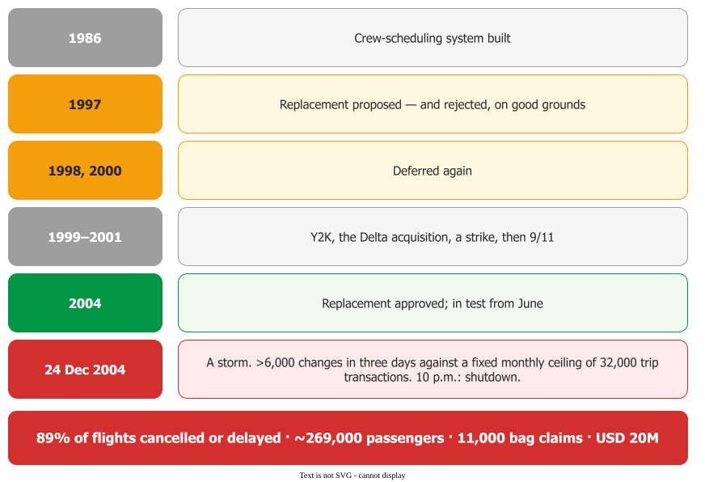
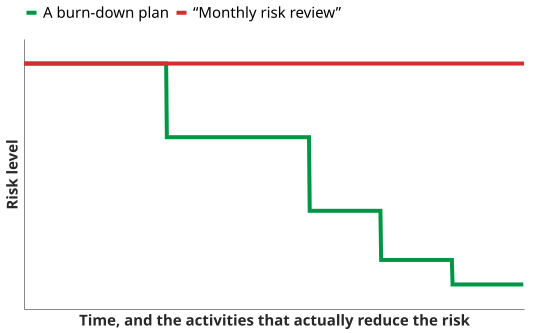

# Capturing, Owning and Mitigating Risks

A risk statement records a **condition that is true today** and the **concern** that follows. The
standard form is one line : *"Given that condition then there is concern that
(possibly) consequence."*

## 1. Start from something you can check today

Students write risks as predictions: *"the vendor might be late."* The repair is to write the
present-tense fact first. For example, on one programme the recorded conditions were **25% of the
code written against 50% of the schedule consumed**, **five workstations for a team of ten**, and
**the vendor's compiler two weeks late** . Each is observable, so nobody has
to be persuaded of the concern.

## 2. Three formats, one content

*If–then*, *condition–consequence* and *because–event–consequence* carry the same three elements:
the event or condition, the consequence, and the cause where known. Pick one and use it consistently
— a register is readable across teams because the shape is the same
.

**Consequences carry a number and a unit.** *"Supplier quality problems may cause program delays"*
is not a consequence; *"a 30-day delay to the start of testing"* is .
Refinement sharpens the condition while holding the consequence fixed .

{: .warning }
**A well-formed statement can still be a bad one** when it points away from what the team controls:
*"if funding is withheld due to poor test results…"* has the test results as its real subject
.

## 3. A worked case: Comair, December 2004

Comair's crew-scheduling system was eleven years old, written in Fortran nobody at the airline was
fluent in, and the last application on an obsolete platform. It had a **fixed ceiling of 32,000 trip
transactions per month**. Severe weather forced more than 6,000 crew changes between 22 and 24
December 2004; the system hit the limit and shut down just after 10 p.m. on Christmas Eve. The
airline **cancelled or delayed 89% of its scheduled holiday-period departures**, affecting about
191,000 passengers by cancellation and 78,000 by delay , at a cost to
Comair and Delta of about $20 million .

_Not the storm. A hard-coded limit._ 

Every element of a register was present years in advance. A replacement was proposed in 1997,
rejected on good grounds, deferred four times for defensible reasons — Y2K, an acquisition, a
pilots' strike, a downturn — approved in 2004, and still in testing when the failure beat it by
months. It *"could have been avoided if Comair or Delta had done a comprehensive analysis of the risk
that this critical system posed."*

## 4. The register row, and the four responses

A register row carries the statement; the probability, impact and exposure; **one named owner**;
the response; a **trigger and contingency**; and the status with its last change
. For example: *given that the 2-second target has only been tested with
100-page documents, 500-page documents may fail acceptance, delaying release by three weeks · 0.4 ·
3 weeks · 1.2 weeks · owner: the tech lead · response: reduce, build a 500-page test set this sprint
· trigger: more than 2 seconds on 1 November → switch to lazy page loading · open.* A row without
an owner is a worry; a row without a trigger is a plan that never starts.

The response is one of four : **avoid** (change the plan so the risk cannot
happen), **reduce** (lower the probability or the impact now), **transfer** (make another party
carry it, by contract or insurance) or **accept** (live with it and watch). Whichever is chosen,
respond only if it costs less than the exposure it removes.

## 5. Owning and tracking

Planning a response means choosing the action, the **observables**, the **thresholds** that say
performance is still acceptable, the protocol on exceedance, and the owner. **A mitigation with no
threshold cannot trigger.**

_Mitigations burn risks down. Meetings do not._ 

The cheapest continuous practice is a **top-10 list**, and its value is one column: *last week's
rank* . Review it weekly with the boss present, and keep the risks that
**dropped off** on it .

Mitigation needs to be a plan rather than a meeting: *"risk burn-down plans should be time-phased and
include specific measurable mitigation activities; **meetings do not burn down risks**"*
. And **expect total exposure to rise before it falls**: on one twelve-month
project it went from 43 days of expected delay to 46.5, then down to 3
. A flat or rising line **late** is the warning.

## How solid is this?

- **Where it comes from.** Two SEI reports, two government guides, a textbook and a conference
  paper. None measures whether any of this improves outcomes.
- **What is contested.** No source shows that condition–consequence registers outperform free text.
- **What we do not hold.** The Comair figures are the federal audit's; the decision history is trade
  journalism.

---

### Acknowledgments

This page adapts material from lectures by Eduardo Miranda and David Root
 on software project management.

### References



---

{: .highlight }
**Disclaimer:** AI is used for text summarization, polishing and explaining. Authors have verified all facts and claims. In case of an error, feel free to file an issue.
