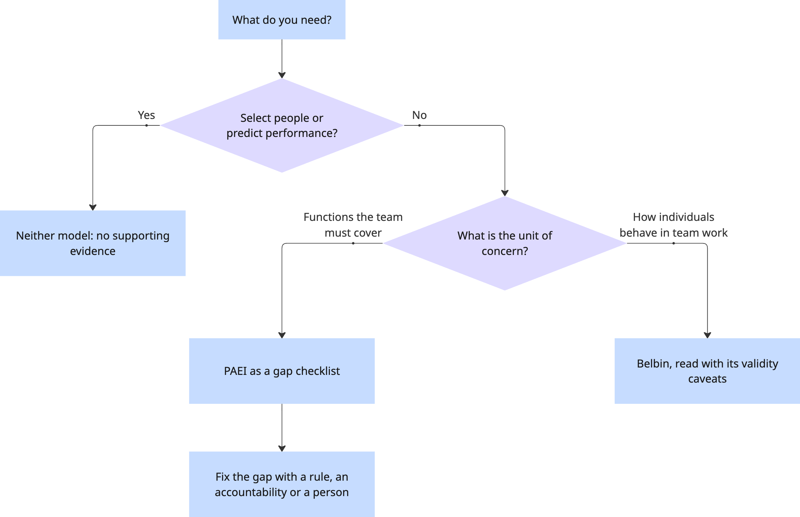

# Adizes' PAEI in Modern Software Teams: Comparing PAEI with Belbin's Team Roles

## Abstract

Ichak Adizes argues that every managed unit needs four roles - **P**roducing results,
**A**dministering, **E**ntrepreneuring and **I**ntegrating - and that no single person performs all
four well. This page asks whether that model still fits a modern software team, where the roles are
spread across Scrum accountabilities and partly built into tooling, and compares it with Belbin's
team roles. The finding: PAEI is a useful vocabulary for spotting a missing function in a team, but
it is a weak measurement instrument, its evidence base is thinner than Belbin's, and no study has
tested it on software teams.

---

## 1. Introduction

### Context & Motivation

Software managers reach for role models when a team "feels unbalanced": plenty of code ships, but
nobody owns quality, or direction keeps changing, or people stop talking to each other. PAEI is one
of the oldest such models and is widely taught in management courses, but it was built for
executives in the 1970s, not for self-managing product teams that work with CI pipelines and AI
coding assistants.

This analysis answers three questions:

- Do the four PAEI roles map onto how a modern software team is organised?
- What changes when a role is carried by a process or a tool rather than by a person?
- How solid is the evidence, compared with the better-studied Belbin model?

### Scope

This analysis compares PAEI and Belbin's team roles across the following dimensions:

- **Unit of analysis** - what the model describes: functions, people or behaviours
- **Fit with software team structures** - Scrum accountabilities, self-management, tooling
- **Evidence base** - independent studies and psychometric testing of the instruments
- **Practical use** - what a manager can actually do with it

---

## 2. Background

### PAEI (Adizes)

**What it is:** a model of the roles a unit needs to be managed well. Adizes defines the purpose of
management as keeping an organisation effective and efficient in both the short and the long run,
and assigns one role to each combination :

| Role | Short form | Makes the unit… | Typical question |
|---|---|---|---|
| **P** - Producer | results | effective in the short run | *What* must we deliver? |
| **A** - Administrator | systems, rules | efficient in the short run | *How* do we do it reliably? |
| **E** - Entrepreneur | change, direction | effective in the long run | *Why* this, and what next? |
| **I** - Integrator | people, cohesion | efficient in the long run | *Who* works with whom? |

**Key characteristics:**

- **No ideal manager.** The roles pull against each other (results now against rules, change
  against stability), so one person cannot excel at all four. The answer is a *complementary team*
  built on mutual trust and respect .
- **Style codes.** A capital letter marks a strong role, a lower-case letter an adequate one, and a
  dash a role below threshold, so a results-driven lead with some feel for process reads `PaE-`.
- **Mismanagement styles.** When only one role is present, Adizes predicts a recognisable failure
  :

| Code | Name | What the team experiences |
|---|---|---|
| `P---` | Lone Ranger | The manager does everything personally and is overloaded while the rest of the unit is underused |
| `-A--` | Bureaucrat | Form and procedure matter more than results |
| `--E-` | Arsonist | A stream of new ideas and shifting priorities; little gets finished |
| `---I` | SuperFollower | Harmony and consensus are pursued for their own sake; hard calls are avoided |
| `----` | Deadwood | No role is performed above threshold |

**Sources:** Adizes's 1976 article in *California Management Review*
 and the book *Management/Mismanagement Styles*
, second in his three-book leadership series.

### Belbin's Team Roles

**What it is:** a model of how individuals tend to behave inside a team, derived from Belbin's
observational research on management teams .

**Key characteristics:**

- Nine roles: Plant, Resource Investigator, Coordinator, Shaper, Monitor Evaluator, Teamworker,
  Implementer, Completer Finisher and Specialist (the ninth was added after the 1981 book).
- Measured with the Team Role Self-Perception Inventory (SPI); a balanced team covers the roles.
- Roles describe *behaviour in team work*, separate from a person's job title or technical function.

**Sources:** Belbin ; review of validity by Aritzeta, Swailes and Senior
.

---

## 3. Comparative Analysis

### Comparison Matrix

| Dimension | PAEI | Belbin |
|---|---|---|
| **Describes** | Functions a unit must cover (also used as personal styles) | Individual behaviour in team work |
| **Granularity** | 4 roles | 9 roles |
| **Origin** | Consulting practice of the author and his institute | Observational research on management teams |
| **Instrument** | Adizes questionnaire: 20 forced-ranking items  | Team Role Self-Perception Inventory |
| **Independent evidence** | Few studies, none in software | Review of 43 empirical studies  |
| **Strengths** | Small, memorable; ties roles to organisational outcomes; names failure patterns | Finer-grained; more psychometric testing |
| **Weaknesses** | Little validation; blurs "role" and "person type" | Weak discriminant validity between some roles |
| **Best for** | Spotting which function a team is missing | Discussing how members contribute in meetings and joint work |

### Detailed Analysis

#### Dimension 1: Fit with a modern team structure

**PAEI:** the four roles map reasonably onto the three accountabilities of the 2020 Scrum Guide
. The mapping below is this page's interpretation, not a claim made by
Adizes or by the Scrum Guide:

| Role | Where it lives in a Scrum team | Where tooling carries part of it |
|---|---|---|
| **P** | Developers create a usable Increment each Sprint | AI coding assistants raise raw output |
| **A** | Definition of Done, which the Developers must conform to | CI, required reviews, linters, branch protection |
| **E** | Product Owner: Product Goal and backlog ordering | Analytics inform the choice but do not make it |
| **I** | Scrum Master: team effectiveness, coaching self-management; the Retrospective | Very little - chat tools carry messages, not trust |

The fit matters because of Adizes's central claim: a unit fails when a role is missing, not when a
person is imperfect. Scrum makes the same move by defining accountabilities rather than personality
requirements, and it asks a *self-managing* team to decide internally who does what
. PAEI therefore works better as a checklist of functions than as a
label for individuals.

**Belbin:** describes behaviour in team work, so it says little about who owns the backlog or the
quality bar. It fits retrospectives about collaboration better than questions of accountability.

**Trade-offs:** PAEI covers organisational functions and loses individual nuance; Belbin covers
individual behaviour and loses the link to who is accountable for results.

#### Dimension 2: Roles carried by tools

Adizes describes A as a personal style. In a modern team much of A is encoded in the pipeline: a
change that fails the tests or lacks an approving review cannot merge, whoever wrote it. This is an
argument rather than a finding, but it has two consequences:

- A diagnosis of "weak A" may point to a missing *rule in the system*, not to a missing person.
- When generation of code becomes cheaper, P stops being the scarce role. The bottleneck moves to A
  (verifying what was produced) and E (deciding what is worth producing). See
  [Process Under AI Agents](../../proc/frameworks/agentic.md) for how process changes around agents.

Belbin has no equivalent: its roles are behaviours of people and cannot be delegated to a tool.

#### Dimension 3: Evidence base

**PAEI:** the model rests mainly on Adizes's books and the consulting practice of the Adizes
Institute. Independent tests are few and sit outside software (Section *How solid is this?*).

**Belbin:** better studied. Aritzeta and colleagues reviewed the SPI and 43 empirical studies and
concluded that, on balance, it has adequate convergent validity, but that strong associations
between some roles show weak discriminant validity .

**Trade-offs:** neither model has shown that role composition predicts software team performance.
For personality composition in general, a 22-year review found no such link
; see [MBTI](mbti.md).

---

## 4. Decision Framework

**Use PAEI when:**

- A team or lead group feels unbalanced and you need words for which *function* is missing
- You are staffing a leadership group and want complementary strengths
- You want a short checklist for a retrospective

**Use Belbin when:**

- The question is how individuals contribute to discussion and joint work
- You want an instrument with a published body of psychometric testing

**Use neither when:**

- Hiring, selecting or predicting performance - no evidence supports either model for this
- Assigning tasks by "type" instead of by skill and interest

---

## 5. Key Findings

1. **The roles still map, but onto a system, not onto people.** P, A, E and I correspond to
   Developers, the Definition of Done, the Product Owner and the Scrum Master - and A is
   increasingly encoded in tooling.
2. **PAEI's strongest use is diagnostic vocabulary.** Naming a missing function (`P---` at team
   level) gives a team something concrete to fix.
3. **The evidence is thin.** PAEI has fewer independent tests than Belbin, none in software, and
   neither model has been shown to predict software team performance.

---

## How solid is this?

- **The source is the author's own practice.** PAEI rests mainly on Adizes's books and the
  consulting work of his institute . The 1976 article
   is conceptual, not an empirical test.
- **Validity is often assumed rather than shown.** Kordova and Hirschprung used the Adizes
  questionnaire with **40** valid respondents (of 59), recruited through a PMI branch, most with over
  ten years' seniority. They state that no further psychometric validation was needed because the
  tool was validated during its development - and the reference they give for that is a wiki page,
  not a validation study . Their study demonstrates a scoring method;
  by their own account it does not assess managers.
- **The best independent study is outside software.** Shaimerdenova and Zhetpisbayeva surveyed
  **150** civil servants in Kazakhstan once (March–May 2024). Most respondents leaned on P and A,
  and motivation was higher in departments with a balanced role distribution
  . This is a correlation in one public-sector sample; it does not
  show that balancing roles *causes* motivation, and it says nothing about software teams.
- **Some "empirical" work is not independent.** Research on the related Adizes lifecycle model has
  been co-authored by Adizes and built on the institute's client database
  .
- **No software studies.** We found no peer-reviewed study of PAEI in software development teams.
  Treat every mapping on this page as interpretation.

---

## 6. Limitations & Future Work

**Limitations of this analysis:**

- The Scrum mapping is the author's interpretation, not a claim made by Adizes or the Scrum Guide.
- The literature search covered English-language sources; Russian-language research on Adizes
  was not systematically reviewed.

**Areas for further research:**

- Does a team-level PAEI gap (for example, missing A) predict defects or rework in software teams?
- Does moving A into tooling change which human roles a team needs?

---

## 7. Conclusion

PAEI survives the move to modern software teams better as a list of functions than as a typology
of people. Its four questions - what, how, why and who - map cleanly onto Scrum's accountabilities,
and asking which of them nobody is answering is a cheap, useful retrospective exercise. The
mismanagement styles give teams memorable names for familiar failures.

What PAEI cannot do is measure people or predict outcomes. Its instrument has little published
validation, independent studies are few and outside software, and Belbin's model - itself imperfect
- has a far larger evidence base.

**Recommendation:** use PAEI to ask which function your team is missing, then fix the gap with a
rule, an accountability or a person. Do not use it to hire, to label colleagues or to assign work.

---

### References



---

{: .highlight }
**Disclaimer:** AI is used for text summarization, polishing and explaining. Authors have verified all facts and claims. In case of an error, feel free to file an issue.
