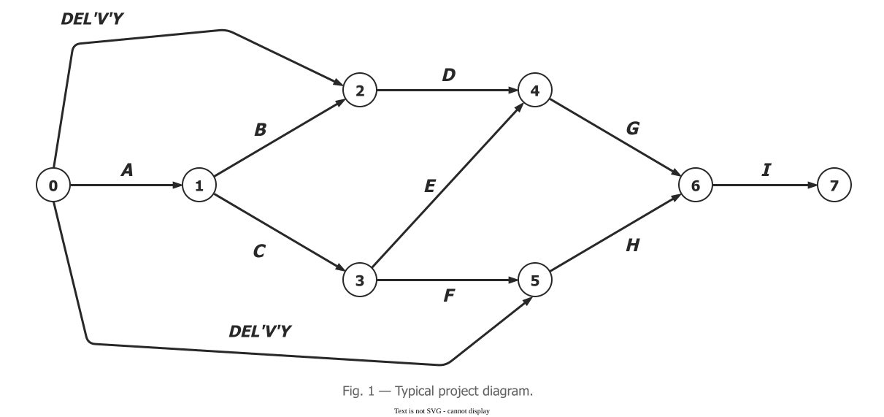

# Activity planning

**Activity planning** turns a milestone plan into tasks: who does which piece of work, in what order,
and what each task must wait for. The inventors of the critical-path method kept order and time apart:
*"We defined planning as the act of stating what activities must occur in a project and in what order
these activities must take place."* Dates come afterwards .

## 1. Who commits to a task: pull or push

In Scrum the team **pulls**. The development team decides what it can deliver, and the ScrumMaster
*"cannot decide on behalf of the development team what commitment to make"*. Rubin warns that
*"assigning tasks to individuals might be harmful if doing so reduces team ownership of the tasks"*
. Capacity is measured first. For example, a team averaging 40 points
plans about 20 for a sprint full of holidays, and checks skills as well as hours.

In a plan-driven project the manager **pushes**: *"Every task that is scheduled should be assigned to a
specific team member."* Its companion is effort validation: three engineers cannot carry seven parallel
half-day tasks .

Under pull the team holds the autonomy and answers to itself for the sprint. Under push the manager
holds the commitment and answers for the whole schedule.

## 2. When: one wave at a time

Both styles plan the detail late. Scrum fixes the work for a sprint *"at the last responsible
moment—the sprint planning for that sprint"* . In a plan-driven project,
*"The activity planning for achieving a specific milestone may wait until close to the starting of the
work on this milestone"*, because planning early means *"the planner chooses early solutions, not
optimal solutions"* . That is
[rolling wave planning](../scope/wbs/waves) .

## 3. The activity network

An **activity network** records which task waits for which. The 1959 method drew tasks as arrows and
needed dummy activities; today's activity-on-node form puts tasks in boxes and needs none
. It can also carry lags and percent-complete conditions
.

*Kelley and Walker 1959, Fig. 1.*

People are left out on purpose: *"Considerations of available
manpower and equipment are conspicuous by their absence"* . What the network
gives instead, in Brooks's words: *"Such a network shows who waits for what."*


## 4. Example: four dependency types in Quill

Quill is a fictional word processor going live at a publishing house. Each dependency has a reason:

| Type | Quill example | Reason |
|---|---|---|
| **Finish-to-start (FS)** | Tuning for 500-page documents starts when the new PDF engine is in | Technical: nothing to tune before |
| **Start-to-start (SS)**, 1-week lag | Translating the help centre starts a week after writing it starts | Management: accept rework to save time |
| **Finish-to-finish (FF)** | The citation-style guide cannot finish before the last style does | The guide covers every style |
| **Start-to-finish (SF)** | The old word-processor licences end only after Quill goes live | The legacy system stops once the new one runs |

The reason decides whether a link can change: management dependencies *"can be reversed, while
technical dependencies cannot"*. Wysocki calls FS *"the simplest and most risk-averse of the four
types"*, so start with FS everywhere and relax a link to SS or FF only when the date demands it
. Relaxing buys time with the risk of rework.

## 5. When to use it, and where it misleads

Use a network when several people's work interlocks and the order is not obvious. Skip it inside a
sprint, where the team sequences its own tasks.

Expect the first draft to be wrong: *"The first chart is always terrible."* Drawing it is still the most
valuable part, because it forces dependencies into the open . And a
network gives no dates by itself. The [critical path](critical-path) computes them, [PERT](pert) shows
why they come out early, [resource planning](resources) fits them to people, and a
[Gantt chart](gantt) displays them.

## How solid is this?

- **Where it comes from.** The inventors' 1959 report, practitioner and software engineering textbooks,
  a defence-acquisition guide and a Scrum practitioner book. No study compares pull with push.
- **What is ours.** *Pull* and *push* are the lecture's words; Rubin and Pressman supply the
  mechanisms without using them. The Quill dependencies are constructed for teaching.

---

### Acknowledgments

This page adapts material from lectures by Eduardo Miranda 
on software project management.

### References



---

{: .highlight }
**Disclaimer:** AI is used for text summarization, polishing and explaining. Authors have verified all facts and claims. In case of an error, feel free to file an issue.
