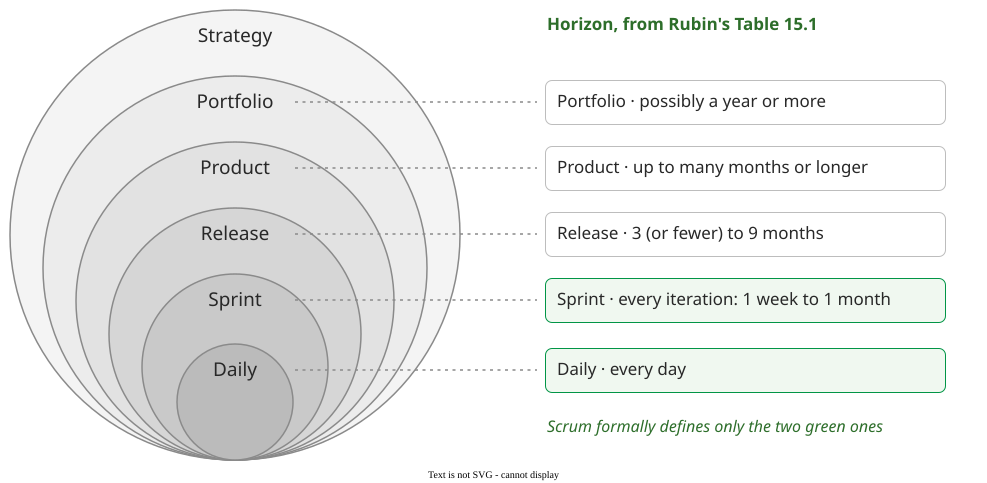

# Planning approaches

A **plan** is a set of documented agreements on what will be delivered, when, and by whom
. A **planning approach** decides when those agreements are made,
who makes them, and which coordination mechanism carries them.

## 1. A plan is coordination prepared in advance

Coordination means *"managing dependencies among tasks"* . Teams
manage them in four ways, and every real team uses all four:

| Mechanism | Software example | Its cost |
|---|---|---|
| Reference to a higher level | the tech lead rules on an interface dispute | one person becomes the bottleneck  |
| **Preparation** | the release plan, the interface specification | breaks on the uncertain parts of the work |
| Shared representations  | the code, the task board, the CI dashboard | someone must keep them current |
| Communication | the stand-up, the design review | suffers first when the team is split |

A plan is the preparation row. Routine dependencies can be coordinated *"mechanistically"* through
plans, schedules and specifications; surprises such as missed deadlines need coordination
*"organically"*, through communication . Distance damages talk
before it damages a plan. In a two-site telecom team, two network elements *"worked well
individually, but not together because the specs were misinterpreted, which delayed the testing by
six weeks"* .

## 2. What a plan is for

A plan does not stop change. *"Its purpose is to help assess and measure the impact of changes on
previous commitments so that informed decisions can be made"* . When
DuPont changed about 40% of a critical-path plan, re-planning took about 10% of the original effort
.

Agile teams agree: Scrum teams *"often spend more time planning with Scrum than with traditional
development"*, in smaller pieces and closer to the work . The lecture
adds an analogy: a good plan has the properties of a good program. Booking one developer on two
tasks at once is a race condition; a circular dependency is a deadlock.

## 3. Predictive and agile plans decide the same things at different moments

Both approaches answer the same questions, at different times and by different people
:

| Decision | Predictive | Agile (Scrum) |
|---|---|---|
| What deliverables? | WBS, at the start | product backlog, at the start and later |
| When delivered? | milestone plan, at the start | item priority; no firm date |
| What tasks? | WBS, at the start and each planning wave | sprint backlog, at sprint planning |
| When executed? | network and Gantt chart; the manager assigns (**push**) | when someone is free (**pull**) |
| Who does it? | responsibility matrix | task board, at the daily scrum |

Push, in a standard text: *"Every task that is scheduled should be assigned to a specific team
member"* . Pull, in the Scrum Guide: *"The Sprint Backlog is a
plan by and for the Developers"* . Agile planning still has
horizons: Rubin names five, from portfolio down to release (up to nine months), sprint (one week to
one month) and the day .

*Rubin 2012, Fig. 15.1; horizons from Table 15.1.*

Which way to lean depends on how much will change before you get there. Stable requirements,
large teams and safety-critical work favour a predictive plan; a product still being discovered by
a small, skilled team favours agile planning. Boehm and Turner call these a method's
[home ground](../proc/frameworks/balance) .

## 4. Two plans, two readers

A **sponsor-oriented plan** lists results the sponsor can check, with dates. It is the
[milestone plan](milestones), *"read and understood without having any detailed insight into the
underlying activities"* . A **developer-oriented plan** lists
iterations, phases, tasks and owners: the plan the team runs.

For example, Quill is a fictional word processor built for a publishing house. *"Iteration 3
done"* tells the publisher nothing she can check; *"When the publisher has agreed the Quill 1.0
feature list"* does. A changed task order is the team's business. A changed result or date is a
renegotiation with the sponsor.

The limitation applies to both plans. Up-front plans *"very accurately encode our early
ignorance"* : they cover only the dependencies someone foresaw, and
talk must handle the rest.

## How solid is this?

- **Where it comes from.** One field study of one telecom team at two sites, 32 coded interviews,
  counting who mentioned a problem rather than how often it occurred
  ; and one eight-month study of one design project
  . Herbsleb 2007 is a roadmap with no data of its own.
- **What we do not hold.** *Reference to a higher level* is hierarchy in the classic organisational
  literature, which is not in this bibliography. Earlier versions credited the four-row table to a
  2009 Herbsleb talk that could not be traced.
- **What is the lecture's.** The good-plan analogy and the term *developer-oriented plan*. The
  re-plan figure is the CPM inventors' own report of one project; Rubin and Pressman are
  practitioner books, and the Scrum Guide is normative.

---

### Acknowledgments

This page adapts material from lectures by Eduardo Miranda 
on software project management.

### References



---

{: .highlight }
**Disclaimer:** AI is used for text summarization, polishing and explaining. Authors have verified all facts and claims. In case of an error, feel free to file an issue.
