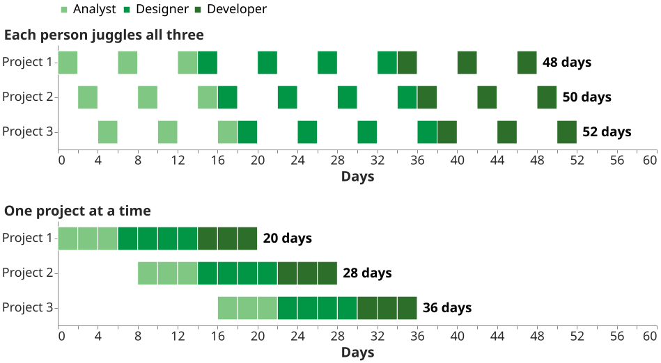
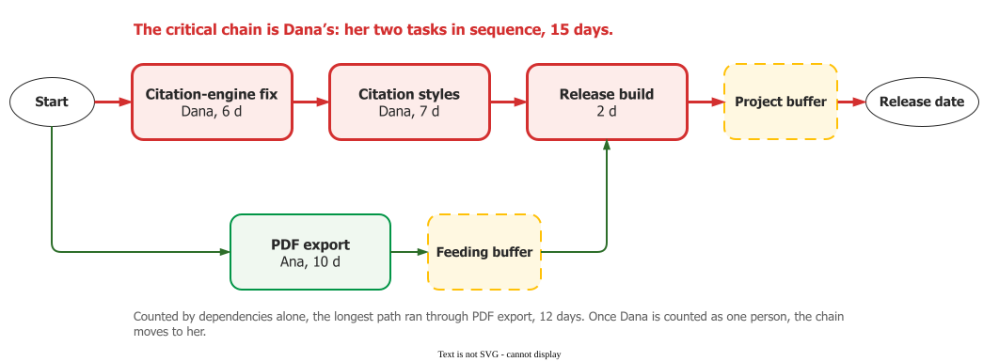

# Critical chain

**Critical chain project management (CCPM)** schedules a project on its **critical chain**, the
tasks that fix the project's duration once both precedence and shared resources are counted, and
protects the date with pooled buffers instead of safety hidden in each task .
Eliyahu Goldratt proposed it in *Critical Chain* (1997), a business novel .

## 1. Where the safety goes

In Rand's summary, *"Goldratt argues that the main reason for project overrun is because of the
misuse of the safety time created within the estimated times for each activity."*
. The padding is not the cause; it is wasted, in three ways:

- work starts late because the safety is known to be there, which Goldratt calls the *student
  syndrome*, *"leaving everything to the last minute"*;
- a task finished early is not reported, since that invites a shorter estimate next time;
- multitasking pulls people off a task once it has started.

*Zultner 2003, Figs. 9–10.*

The second is usually credited to Parkinson: *"It is a commonplace observation that work expands so
as to fill the time available for its completion."* . The behaviour has
been measured under neither name: students given one week for a one-hour task finished it after 4.3
days on average, and those given two weeks after 9.1 .

## 2. Pool the safety, then find the chain

For example, Zultner takes three 10-day tasks, each five days of work and five of safety: 30 days. Pool the safety, as insurers pool risk, and one 8.66-day buffer gives the same 90%
protection: about 24 days. Half the tasks will then overrun:
*"The only way you will get accurate 50% likely expected task times is if it is OK to exceed them."*


The chain is the longest path once tasks sharing a person are sequenced, a *"leveled critical
path"* ; see [Critical path](critical-path) and [Resource planning](resources).

## 3. Buffers and relay runners

The pooled safety goes into a **project buffer** at the end of the chain; **feeding buffers** where
other paths join it, so chain tasks never wait; and **resource buffers**, which are advance warnings
rather than time  . Feeding buffers answer
merge bias, where a merge point *"passes on the longest delay"* ; see
[PERT and merge bias](pert).

People on the chain work like relay runners: start the moment the predecessor finishes, work flat
out, hand off at once, and give the next runner a countdown . Nobody is
criticised for one late task. The manager watches the buffer instead, in thirds: while the first third
is used, do nothing; in the middle third, plan a response; in the last third, act
. Abbott Diagnostics, Brandt reports, reviewed its buffers weekly
.

## 4. Example: one developer moves the date

Quill is a fictional word processor. Before its 2-day release build come Ana's PDF export (10 days)
and Dana's citation-engine fix (6) and citation styles (7). The critical path runs through PDF export,
12 days, so everyone watches Ana. But Dana cannot do both her tasks at once; in sequence they make
the longest path, 15 days. The chain is Dana's, and PDF export becomes a feeding path.

So the manager watches Dana's queue, not Ana's progress.

Gelbwaks describes Segway running critical chain over agile iterations: agile decided what each
iteration held, while a chain of stories decided when hardware, software and mechanics
came together .

## 5. When to use it, and what to keep

Raz and colleagues would adopt the whole package only where planning is weak, many similar projects
share people, and deadlines dominate; not in mature organisations or one-off work
. Elsewhere, keep the buffers and drop the rules sold with them. Size buffers
from the chain's risk, not as half its length. Re-identify the chain when delays change the
schedule; it moves . Treat "cut every estimate by half"
as a guess about your own people, not a law.

## How solid is this?

- **The premises.** Goldratt argues from a novel. The student syndrome has no
  study behind it, and Parkinson's Law proper is about headcount.
- **Are estimates padded?** Leach says people pad, then finish on the date .
  In one IS department, of over 500 tasks 8% finished on estimate, about 60% early and 32% late
  .
- **The arithmetic.** Simulated, the 50% rule added a 65% buffer to the scheduled duration,
  against 42% for risk-sized buffers; one update in three produced a resource conflict
  .
- **Does it work?** Of 140 CCPM papers, 8% are empirical; 20 case reports average 40% shorter,
  uncontrolled . No comparative study shows adopters outperform
  .
- **The cases are advocacy** from vendors and adopters. Abbott's projects are measured against
  their own CCPM schedules, which shows reliability, not speed. Gelbwaks:
  *"It is hard to tell how much time the CCS approach has saved Segway"* .

---

### Acknowledgments

This page adapts material from lectures by Eduardo Miranda 
on software project management.

### References



---

{: .highlight }
**Disclaimer:** AI is used for text summarization, polishing and explaining. Authors have verified all facts and claims. In case of an error, feel free to file an issue.
