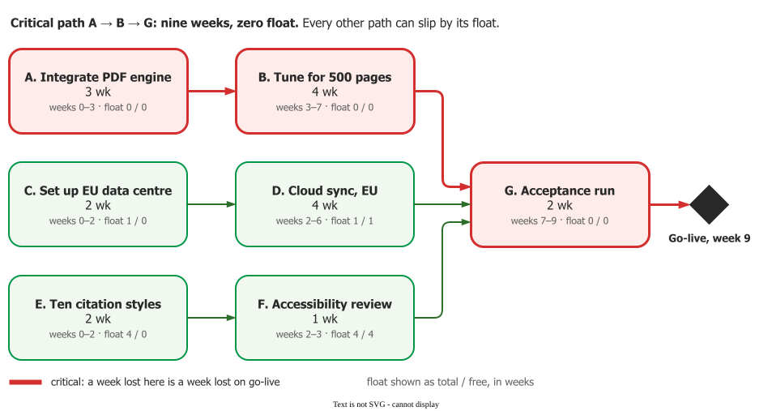
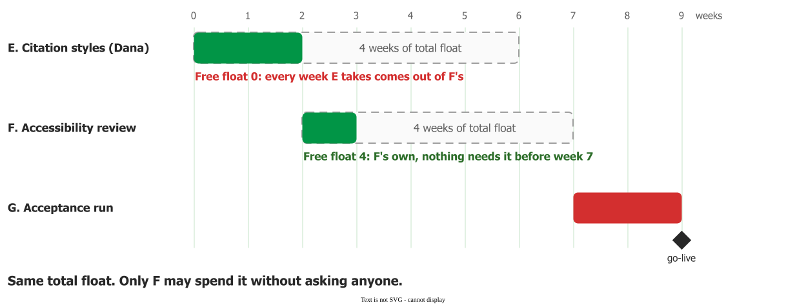

# Critical path and float

The **critical path** is *"the sequence of activities that must be completed on schedule in order for
the project to be completed on schedule"* . **Float** (or slack) is how far
any other task can slip before it, too, moves a date that matters.

## 1. What it is

The method comes from DuPont and Remington Rand UNIVAC, developed in 1957 and published in 1959. Its
rule: *"A delay in a critical job will cause a comparable delay in the project completion time"*
. Brooks put it in a manager's terms: the network *"shows who is on the critical
path, where any slip moves the end date"* .

## 2. How the two passes work

The **forward pass** walks the [activity network](activities) from the start: each task begins as soon
as its last predecessor finishes, giving its **earliest start** and the project's shortest length. The
**backward pass** walks back from that finish: each task must end before its first successor has to
start, giving its **latest finish**. Float is the window between the two, minus the duration. Tools do
the arithmetic; the manager reads the result.

## 3. Example: the last nine weeks of Quill

Quill is a fictional word processor, nine weeks from going live at a publishing house. Three streams of
work merge into one acceptance run (durations in weeks).

The passes give each task its float, in weeks:

| Task | Total | Free | What it means for the manager |
|---|---|---|---|
| A, B, G | 0 | 0 | Critical: a week lost here is a week lost on go-live |
| C. Set up EU data centre | 1 | 0 | One spare week, shared with D |
| D. Cloud sync | 1 | 1 | The week is D's only if C finishes on time |
| E. Citation styles | 4 | **0** | Dana may slip four weeks, but every week she takes is F's |
| F. Accessibility review | 4 | **4** | The reviewer's four weeks are his alone |

The critical path is A–B–G, nine weeks. For example, the vendor's PDF engine arriving a week late moves
go-live by a week; setting up the data centre a week late moves nothing, but leaves cloud sync no margin.

## 4. Total float and free float

Kelley and Walker defined four kinds of float ; managers use two
:

- **Free float** is *"the range of dates in which an activity can finish without causing a delay in the
  early schedule of any activities that are its immediate successors."*
- **Total float** is *"the range of dates in which an activity can finish without delaying the project
  completion date."*

Total float belongs to the path: *"Slack is not additive along a path; it must be shared by all
activities on the path"* ; the first task to spend it takes it from
the ones after. So **free float is the one for task-level decisions**: a developer can spend it without
disturbing anyone. Quill's E and F show the same four weeks of total float, yet only F's are its own.
Before telling someone they have float, say which kind.

## 5. Near-critical paths

A path nearly as long as the critical one deserves the same attention: *"It is very likely that this
near-critical path may actually drive the project completion date even though the total path length is
less than that of the critical path"* . Quill's C–D path is one week short,
and [PERT and merge bias](pert) shows why that week is thinner than it looks. The critical path also
moves when a task changes, so recheck it after every change.

## 6. When to use it, and where it misleads

Use it to decide where money and attention go. On DuPont's first test, a $10 million plant with 393
jobs, *"only a very few jobs were critical - about 10% - and only these needed expediting"*: two months
came off the schedule at no extra cost, and two more for a 1% rise in direct cost
.

The limits are built in. The passes assume known durations and that anyone can start any task the
moment it is free. The computed date is therefore a lower bound: [PERT](pert) shows why uncertainty
pushes it later, and [resource planning](resources) why people do.

## How solid is this?

- **Where it comes from.** The inventors' own report, whose DuPont figures are self-reported with no
  independent comparison; a practitioner textbook; a defence-acquisition primer.
- **What is contested.** Slack definitions drift; one textbook joins free and total float with "or"
  . The Quill network is constructed for teaching.

---

### Acknowledgments

This page adapts material from lectures by Eduardo Miranda 
on software project management.

### References



---

{: .highlight }
**Disclaimer:** AI is used for text summarization, polishing and explaining. Authors have verified all facts and claims. In case of an error, feel free to file an issue.
