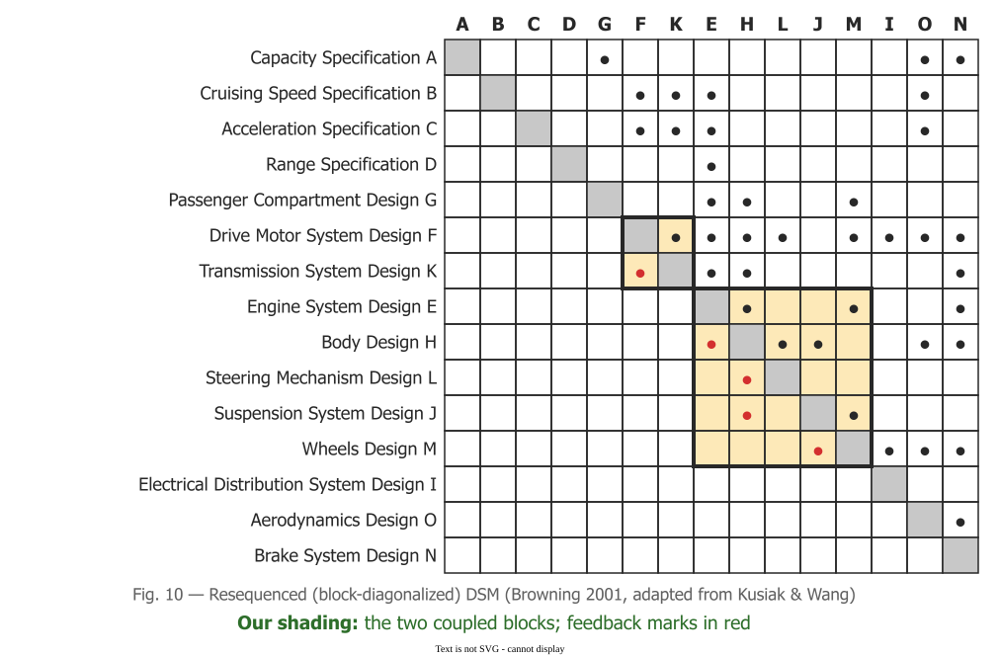

# Design Structure Matrix

A **Design Structure Matrix (DSM)** is *"a square matrix with identical row and column labels"*:
each task sits on the diagonal, and a mark off it says that one task needs information from another
. In planning, it shows where work loops back, which an activity network
cannot draw.

## 1. How to read one

This page uses Browning's convention: **a row shows what a task provides, a column what it needs**.
List the tasks roughly in the order they will run. Marks above the diagonal then pass information
forward, and *"Subdiagonal elements indicate feedback—the potential for iteration and rework in the
process."* . Two tasks with marks on both sides of the diagonal are
**coupled**: each needs the other's output.

Steward, who introduced the matrix in 1981, drew the transpose, with feedback *above* the diagonal
. Check a matrix's convention before reading it.

## 2. What it shows that a network cannot

The passes of the [critical path method](critical-path) need a network without loops, and design work
has them. Steward's example: *"the size of the heat exchanger depends upon the coolant temperature,
but the coolant temperature depends upon the size of the heat exchanger."* .
In a DSM the loop is a mark below the diagonal, and coupled tasks form a visible block: *"a capability traditional PERT/CPM techniques cannot deliver"* .

## 3. Partition, tear, then schedule

**Partitioning** reorders rows and columns so that as few marks as possible stay below the diagonal,
*"pulled as close to the diagonal as possible and grouped in blocks"*. Each block must be planned as a
unit. In one automobile design process Browning reviews, 15 activities partitioned into just two
coupled blocks .

*Browning 2001, Fig. 10, after Kusiak and Wang; shading ours.*

A block can be merged into one task, which Browning rejects because it hides the problem; decomposed
into smaller steps that run in order; or **torn**: *"The least-damaging assumptions are made first,
and their marks are temporarily removed or "torn" from the DSM"* . A tear is
a guess about an input that has not arrived, so it is a risk decision, and Steward puts a design
review at the end of each block to check it. The torn, ordered matrix is an ordinary network: the
method *"does not replace critical path"* but comes before it .

## 4. Four kinds of DSM

Browning sorts DSMs by what the rows are :

| Type | Rows are | Used for | Analysis |
|---|---|---|---|
| Component-based | parts of a product | architecture | clustering |
| Team-based | people or teams | organisation design | clustering |
| Activity-based | tasks, with inputs and outputs | scheduling | sequencing |
| Parameter-based | design parameters | low-level sequencing | sequencing |

Only the two time-ordered kinds can show feedback.

## 5. Example: Quill's typesetting design

Browning's one software case is a Boeing wing-analysis tool, planned with its subroutines as rows
and their data exchanges as marks .

For example, take Quill, a fictional word processor, early in its design, with five tasks in the
order the team expected to do them:

| | 1 | 2 | 3 | 4 | 5 |
|---|---|---|---|---|---|
| **1 Layout engine** | ■ | × | × | × | |
| **2 Pagination** | | ■ | × | × | × |
| **3 Footnotes and citations** | | **×** | ■ | × | × |
| **4 PDF export** | | | | ■ | × |
| **5 Performance tuning** | | | | | ■ |

Row 3, column 2 is the loop. Footnote length changes where pages break, and a citation reading
*"see p. 12"* needs the page break first, so tasks 2 and 3 are coupled. The team tears the block:
it estimates the footnote space per page, paginates on that guess, lays out the citations, then
reviews whether the guess held. Everything else feeds forward into the schedule.

## 6. When to use it, and when not

Use a DSM for design work whose tasks are coupled, where rework comes from information arriving at
the wrong time. Start small: under ten elements can be read by eye, and larger matrices are built by
joining smaller ones .

Do not ask it about time: *"A Gantt chart remains one of the best representations of activity
concurrency"*, so see [Gantt charts](gantt). A single DSM shows one process flow, not the
alternatives, and interviews tend to describe how work is supposed to flow rather than how it does.
Overlapping tasks without checking the matrix *"can result in additional iteration and increased lead
time"* .

## How solid is this?

- **Where it comes from.** Browning's paper is a peer-reviewed review and tutorial, written from
  inside the DSM community. Its cases are cited from others, and none reports a measured saving.
- **What is ours.** The Boeing tool is the only software case. Using a DSM to plan a software
  project is an extrapolation, and the Quill matrix is constructed for teaching.
- **What is not covered.** Neither source discusses agile or rolling-wave planning.

---

### Acknowledgments

This page adapts material from lectures by Eduardo Miranda 
on software project management.

### References



---

{: .highlight }
**Disclaimer:** AI is used for text summarization, polishing and explaining. Authors have verified all facts and claims. In case of an error, feel free to file an issue.
