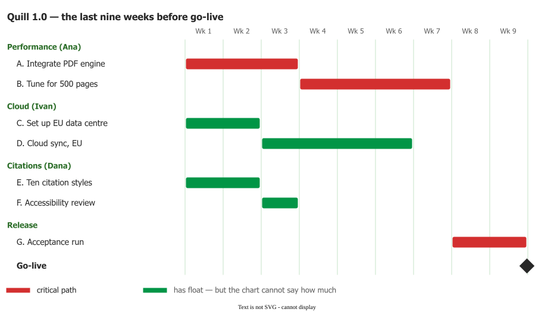

# Gantt charts

A **Gantt chart** is a calendar of a plan: one bar per task on a time axis, showing when each task
runs, how long it takes, who is on it and what runs in parallel .
It displays the dates a network computes; it does not compute them .

## 1. What it shows

Pressman calls it a time-line chart: *"When multiple bars occur at the same time on the calendar,
task concurrency is implied. The diamonds indicate milestones."* He pairs it with a project table of
planned and actual start and finish dates, so the same chart serves planning and tracking
. Modern tools add colour for critical tasks, slack, work in progress
and late work , and a chart rolls up cheaply from task level to a one-line
summary for a steering group .

That combination is the chart's origin. Henry Gantt published his charts in 1903 as a factory
production-planning tool, and *"The intimate relationship between planning, monitoring work against
plan and subsequent control action was directly represented on the chart."* The earliest project
Gantt chart Wilson found in print is from 1941, and CPM and PERT did not grow out of its weaknesses
.

## 2. Example: the last nine weeks of Quill

Quill is a fictional word processor, nine weeks from going live at a publishing house. The plan
below has three streams of work that merge into one acceptance run. Its layout follows Pressman's
chart for a word-processing product: bars, owners in the section names, a diamond for the milestone.

{: .note }
The layout is rebuilt from Pressman's Fig. 27.3, a time-line chart for a word-processing product
. The tasks are Quill's, and they are the same network that
[Critical path](critical-path) computes.

A status meeting reads this in seconds: three streams in parallel, acceptance starting in week 8,
Dana free after week 3. Now the sponsor asks whether setting up the EU data centre can wait two weeks
while the hosting team finishes another job. The chart shows a one-week gap between cloud sync and acceptance, so it
*looks* like one week. It cannot say why. That answer comes from the network: the contract feeds cloud
sync, which feeds acceptance, and the path has one week of total float, shared by both tasks. So the
answer is one week, and taking it leaves cloud sync no margin at all.

## 3. What it hides

Wysocki puts the limit in one sentence: *"Unless you are intimately familiar with the project
activities, you cannot tell from the Gantt chart what must come before and after what."*
. Tools can draw link lines and colour the critical bars, but they draw
them from the network underneath; the chart can show that a bar waits, not explain why.

It hides three more things. A bar is a single date, so the chart shows no uncertainty. It shows who
is assigned, not whether that person is free: two overlapping bars for one developer raise no flag,
and levelling is a separate step. And it cannot show work that loops back, which is what a
[Design Structure Matrix](dsm) is for. The guide the US defence acquisition schools used summarises
it: *"Perhaps the biggest shortfall of the Gantt and milestone charts is that neither of them, nor
the combination of both, allow detailed schedule analysis."* 

## 4. When to use it, and when not

Pick the view by the question being asked:

| View | Answers | Leaves out |
|---|---|---|
| Milestone chart | what must be true, and by when | the work that gets there |
| **Gantt chart** | what runs when, in parallel, by whom; planned vs actual | why a bar must wait; whether the person is free |
| Network | who waits for whom; which slip moves the end date | the calendar at a glance |
| DSM | where information loops back | overlap, and time |

Use the Gantt chart for status meetings, stakeholders and tracking progress against plan. Do not
use it to decide whether a task can move: build the network, then print the Gantt.

## How solid is this?

- **Where it comes from.** A textbook, a defence-acquisition training primer (grey literature), a
  practitioner textbook and one historical review. None reports a study of whether teams that use
  Gantt charts plan better.
- **What is contested.** The date. The defence guide attributes the chart to Gantt's work in the
  First World War; Wilson traces it to his 1903 paper and names the wartime dating as a textbook
  error. Wilson's review is favourable to the chart and says little about its weaknesses on large,
  dependency-heavy projects.
- **What is ours.** The Quill plan is constructed for teaching; only its layout is Pressman's.

---

### Acknowledgments

This page adapts material from lectures by Eduardo Miranda 
on software project management.

### References



---

{: .highlight }
**Disclaimer:** AI is used for text summarization, polishing and explaining. Authors have verified all facts and claims. In case of an error, feel free to file an issue.
