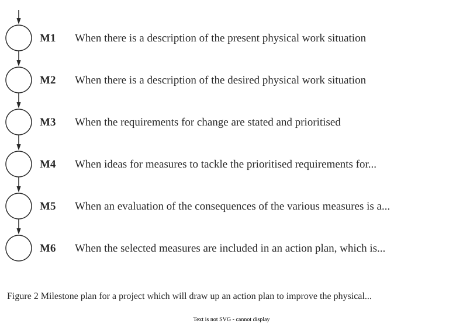
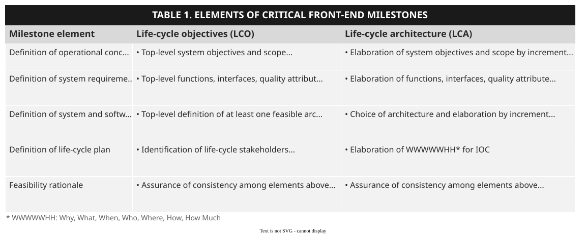

# Milestone planning

A **milestone** is *"a result to be achieved"*: a state the project should reach by a certain time,
which the sponsor can check . **Milestone planning** orders those
results and dates them before anyone plans the activities that produce them.

## 1. Results, not activities

*"A milestone describes what is to be fulfilled, but not the method to fulfil it"*
. Andersen writes every milestone as a state beginning "When…", and
the habit is a test. For example, in Quill, a fictional word processor,
*"coding finished"* is an activity; *"When a 500-page manuscript opens in two seconds on the
publisher's laptop"* is a result. A row of iterations is a
[developer-oriented plan](approaches), not a milestone plan.

*Andersen 1996, Fig. 2.*

| | Milestone planning | Activity planning |
|---|---|---|
| Plans | the results, and their order | the work, and who does it |
| Needs | only the logic of the results | the outcomes of earlier work, not yet known |
| Done | early, for the whole project | per milestone, just before work on it starts |
| Stability | robust, rarely changed  | revised as work goes on |

A project is unique, so *"it is impossible to know all the activities of the project at the initial
planning stage"* . Milestones depend **finish-to-finish**: the
project must reach one state before the next, but work towards a later milestone may start early
. The work itself is [activity planning](activities).

## 2. Make every milestone sharp

*"Milestones must be concrete, specific, measurable events, defined with knife-edge sharpness.
Coding, for a counterexample, is ‘90 percent finished’ for half of the total coding time"*
. McConnell's **miniature milestones**, a day or two long, apply it
inside the team: *"The only two statuses are ‘done’ and ‘not done.’ Percentages are not
used"* .

So a project needs two kinds: **result milestones**, months apart, for the sponsor, and **control
milestones**, days apart, for the team. The lecture's checklist for both: **specific, verifiable,
relevant, timely**.

Sharpness is written down as **exit criteria**: the work items, their state, the quality reached.
[ETVX](../proc/basics/etvx) defined exit criteria for a process activity
. Scrum's **Definition of Done** plays the same role for an
increment: *"a formal description of the state of the Increment when it meets the quality measures
required for the product"* .

## 3. Three anchor points

Boehm proposed three milestones for any process :

- **LCO, life-cycle objectives**: stakeholders agree the objectives, and a feasible architecture
  exists.
- **LCA, life-cycle architecture**: one architecture is chosen and every major risk resolved or
  covered by the risk plan; otherwise *"do not proceed into full-scale development."*
- **IOC, initial operational capability**: software, site and users are ready, *"the milestone with
  the most serious consequences of neglect."*

*Boehm 1996, Table 1.*

## 4. Example: Quill's sponsor-oriented plan

A **hard date** is imposed by a third party, and the result loses most of its value if late; a
**soft date** is agreed between the parties and can move .

| Week | Path | Milestone | Date |
|---|---|---|---|
| 2 | Publisher | When the Quill 1.0 feature list is agreed | soft |
| 6 | Team | When the architecture is chosen and its major risks are covered | soft |
| 18 | Publisher | When the EU data centre contract is signed | soft |
| 23 | Team | When a 500-page manuscript opens in two seconds on the publisher's laptop | soft |
| 25 | Publisher | When the editors start the spring list on Quill | **hard** |

Week 25 is hard because the publisher has announced its spring list to booksellers. Week 6 is
Quill's LCA: the two-second promise, tested only on 100-page documents, is proven or covered. The
last nine weeks appear as a [Gantt chart](gantt).

Place hard dates first, fit soft ones around them within the [hours available](resources), and let
buffers protect hard milestones first .

## 5. When to use it, and its limits

Milestone planning fits best where the route is unclear; Andersen calls it *"not so relevant in
projects with well defined goals and well defined methods"* . It
says nothing about how the work is done, and soft milestones slip quietly. An underestimated task
looks on schedule until about three weeks before it is due , which is
why result milestones need control milestones underneath.

## How solid is this?

- **Where it comes from.** Andersen argues for his own method, with a constructed example. Boehm's claim that the anchor points correlate with success rests on his own review of
  projects, with no counts.
- **Whose words.** *Specific* and *measurable* are Brooks's; *relevant* and *timely*, and the
  result/control pairing, are the lecture's. The three-week figure is a 1967 non-software study,
  via Brooks.
- **What was dropped.** No source shows the Definition of Done descending from ETVX.
- **What is ours.** The Quill plan is invented; the date-setting method is Miranda's course
  practice, not a tested method.

---

### Acknowledgments

This page adapts material from lectures by Eduardo Miranda 
on software project management.

### References



---

{: .highlight }
**Disclaimer:** AI is used for text summarization, polishing and explaining. Authors have verified all facts and claims. In case of an error, feel free to file an issue.
