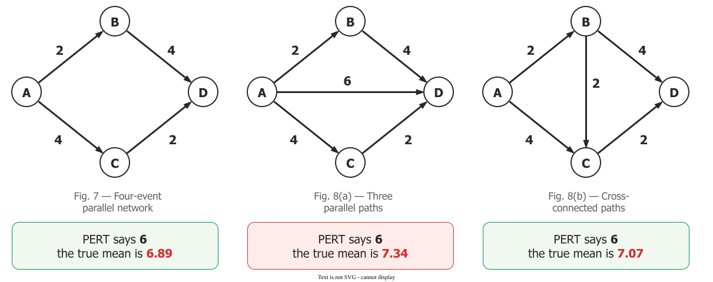
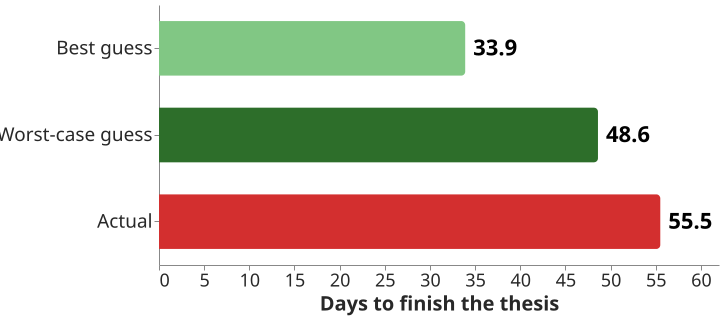

# PERT and merge bias

**PERT** is a network scheduling method that asks for three duration estimates per task, optimistic,
most likely and pessimistic, and computes an expected time from them .
**Merge bias** is why its finish date, like a critical-path date, comes out early: where parallel paths
merge, the project waits for the latest of them .

## 1. Three estimates instead of one

PERT was developed for the US Navy's Special Projects Office with Booz Allen & Hamilton to control the
Polaris missile programme, and published in 1959. Its name first stood for *Program Evaluation Research
Task*. The authors modelled each duration as a beta distribution peaking at the most likely value
, which gives the familiar rule: expected time is the optimistic estimate,
plus four times the most likely, plus the pessimistic, divided by six.

CPM, its twin, uses one number per task. Brooks called any critical-path network a PERT chart
, which is why the two names are used loosely.

## 2. The most likely date is not a likely date

Task durations are skewed: *"while you can do only a limited number of things to shorten the duration of
a task, the number of things that can go wrong is almost unlimited."* In Miranda's illustration, a task
estimated at 10, 20 and 40 days has **under a 40% chance** of finishing by its most likely date. Its
expected finish is about 23 days, and 75% confidence needs 27 .

## 3. Merge bias

A project finishes when its **last** path finishes, and the average of a maximum is never below the
average of any single path. So *"the PERT-calculated mean is generally less than, and never greater
than, the true project mean"* . CPM's inventors had seen the direction,
not the size .

MacCrimmon and Ryavec measured the effect. Two equal, independent paths, each averaging **0.50**: the
later one averages **0.63**. Add a third: **0.69**. PERT reports 0.50 every time
.

*MacCrimmon and Ryavec 1962, Figs. 7–8.*

Miranda's sentence is the one to remember: *"The merged path results in
a mechanism that passes on delays but seldom passes on savings"* .

## 4. Example: Quill's acceptance run

Quill is a fictional word processor whose [critical path](critical-path) is nine weeks. Three paths merge
into the publisher's acceptance run: Ana's PDF work (seven weeks), Ivan's cloud sync (six) and Dana's
citation work (three). The plan starts acceptance in week 8, on Ana's path alone. But Ivan's path is
only a week shorter: a bad fortnight on cloud sync delays acceptance as surely as one on PDF tuning, and
Ana finishing early saves nothing while Ivan is late. For example, if two developers
are each 50/50 to finish by Friday, integration starts on Friday one week in four. Dana's path, less than
half as long, barely matters.

## 5. What makes it worse, and what to do

The bias grows with *"many independently parallel paths having approximately equal durations"*. It
shrinks with slack: when the second of two paths was half as long as the first, PERT's error fell to
half a per cent. It also shrinks when paths share activities .

So the response is targeted, not a flat margin on everything:

- Treat the computed finish as a lower bound, never as the forecast.
- Watch the nearly critical paths as closely as the critical one.
- Where the date matters, simulate the network from per-task ranges .

Software adds a twist. Miranda calls assuming independent task durations *"perhaps one of the most
dangerous assumptions a project manager can make"*: underestimate the system's complexity and every
task sharing that cause runs late together .

## 6. The estimates are short too

Merge bias works even on perfect estimates, and estimates are not perfect. People hold *"a confident
belief that one's own project will proceed as planned, even while knowing that the vast majority of
similar projects have run late"*: the **planning fallacy**. Students forecasting their theses guessed
33.9 days and took 55.5 .

*Buehler, Griffin and Ross 1994, Study 1.*

Why added safety still gets spent is on [critical chain](chain); see also
[why we misjudge risk](../needs/risks/biases).

## How solid is this?

- **Where it comes from.** MacCrimmon and Ryavec's results are analytical, on small constructed
  networks, and they say generalisation is possible *"only to a very limited extent"*. The quotes are
  from the 1962 RAND memorandum behind the journal paper. Miranda's 10/20/40 task is an illustration.
- **What is attributed.** The name *merge bias* is later usage; the report speaks of parallel paths.
- **Who was measured.** The planning-fallacy studies used psychology undergraduates forecasting their
  own coursework, not developers committing to a manager.

---

### Acknowledgments

This page adapts material from lectures by Eduardo Miranda 
on software project management.

### References



---

{: .highlight }
**Disclaimer:** AI is used for text summarization, polishing and explaining. Authors have verified all facts and claims. In case of an error, feel free to file an issue.
