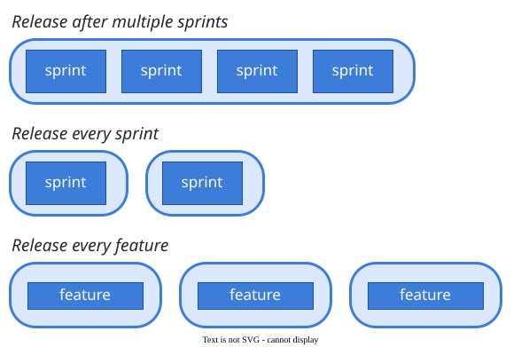

# Release planning

**Release planning** decides which features go into which release, across a sequence of releases,
under limits of effort, budget and dependencies . A release is *"a
collection of features that the customer values"*; the plan commits firmly to the next one and
sketches the rest .

## 1. Release or iteration

A release is what the customer gets: *"a coherent deliverable to customers or users"*. An iteration,
or sprint, is how the team gets there: *"a short-duration, timeboxed iteration"*, and *"a release is
typically composed of multiple sprints"*. Rubin gives typical ranges of three (or fewer) to nine
months for a release and one week to one calendar month for a sprint .
An iteration must end in working software; a release must be useful. Some teams release every
timebox, as one e-store did every three weeks .

*Rubin 2012, Fig. 18.1.*

Both are timeboxes, so in both **the date holds and the scope moves**. Take Quill, a fictional word
processor due for its publisher's spring list. After the third sprint's demo the customer moves
*comments* above *mail merge*. The change waits for the next sprint's planning, the customer decides
on value while the team advises on cost and risk , *mail merge* drops
below the release line, and the spring-list date stays put. Moving the date is the sponsor's separate
decision, never a side-effect of reprioritising.

Releasing early also changes when the money comes back. In Denne and Cleland-Huang's example, one
year of development has a net present value of −$24K as one release and +$205K as four quarterly ones
.

## 2. Approaches compared

| Approach | What it optimises | Inputs needed | Main cost |
|---|---|---|---|
| **MoSCoW**  | a guaranteed minimum plus contingency | a category per feature; Musts at most 60% of effort | the Should/Could line is judgement |
| **Buffered MoSCoW**  | delivery certainty by a fixed date | the customer's order; a normal and a safe estimate per feature | conservative; promises stop at *"short of a calamity"* |
| **Cost–value (AHP)**  | value per unit of cost | pairwise value (customers) and cost (engineers) judgements | n(n−1)/2 comparisons; ignores dependencies |
| **EVOLVE**  | stakeholder urgency against business value, increment by increment | weighted stakeholders' ranks; effort; precedence | data collection; a person picks among several plans |
| **IFM**  | the project's net present value | Minimum Marketable Features; cost and revenue per period | per-feature revenue forecasts from the business |

Buffered MoSCoW simplifies SPID, which plans the first increment at about 95% confidence and
re-plans it at 50% .

## 3. Pages

| Page | The question it answers |
|---|---|
| [Prioritising features](prioritisation) | When not everything fits, what goes in first? |
| [Buffered MoSCoW](moscow) | How many features can a fixed date honestly promise? |
| [Contracts and incentives](incentives) | Who pays when only part of the release arrives? |

## How solid is this?

- **Where it comes from.** Rubin's ranges are typical values from practice. Denne and
  Cleland-Huang's project is hypothetical.
- **What is thin.** Of 24 published release-planning models, four have reports of full-scale
  industrial use .

---

### Acknowledgments

This page adapts material from lectures by Eduardo Miranda 
on software project management.

### References



---

{: .highlight }
**Disclaimer:** AI is used for text summarization, polishing and explaining. Authors have verified all facts and claims. In case of an error, feel free to file an issue.
