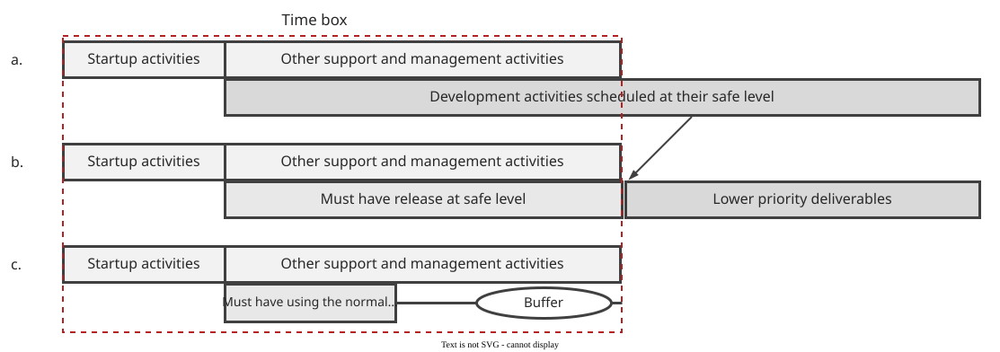
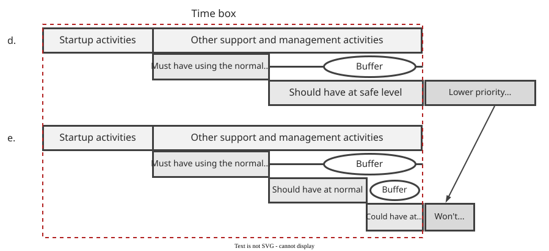

# Buffered MoSCoW

**Buffered MoSCoW** fills a fixed time box with features in the customer's order of preference, and
lets the uncertainty of the team's estimates, not a fixed percentage, decide how many features
become Must, Should or Could Haves .

## 1. Two MoSCoWs

Clegg and Barker coined the categories in 1994 with no cap .
DSDM added an effort ceiling: Musts at *"no more than 60%"*, Coulds *"around 20%"*, and no figure for
Shoulds . Miranda keeps the ranking but changes what the categories mean:

| Category | DSDM: what if it is missing? | Buffered MoSCoW: how likely is it? |
|---|---|---|
| Must | the *"Minimum Usable SubseT"* the project guarantees | deliverable *"short of a calamity"* |
| Should | important but not vital | *"a fair chance of being delivered"* |
| Could | *"the main pool of contingency"* | only *"if everything went extraordinarily well"* |
| Won't | agreed not to be delivered this time | no budget left at its safe estimate |

The customer owns the order; the estimates own where the line falls.

## 2. How it works

Each feature gets two estimates: a **normal** one with a fair chance of being enough, and a **safe**
one that is enough except in a few really bad cases. In five steps :

1. **Musts.** Take features in the customer's order, with their prerequisites, at their *safe*
   estimates until the development budget is used up. A feature that does not fit is passed over.
2. **The Must buffer.** Re-plan the Musts at their *normal* estimates. The time freed is the buffer
   that protects them.
3. **Shoulds.** Choose them in the customer's order, at their *safe* estimates, inside the Must
   buffer. Re-plan them at normal; the time freed is the Should buffer.
4. **Coulds.** The same rule, inside the Should buffer.
5. **Won'ts.** Whatever fits nowhere at its safe estimate.

*Miranda 2011, Fig. 1.*

Each category uses *"the size of the buffer protecting the previous category as the initial budget
for the current one"*. Miranda defines the Must buffer as the Musts' safe total minus their normal
total; his worked example passes on all the budget left once the Musts are at normal. The two agree
when the safe fill uses the whole budget.

Each step roughly halves the odds, so a Must is about twice as likely to be delivered as a Should and
four times as likely as a Could. Miranda gives no fixed percentages.

## 3. A worked release

**Example.** Quill, a fictional word processor, has a 180-hour time box: 60 hours of overhead, 120
for development. The customer ranks twelve features, starting with
*open and save*, *character formatting*, *spell checker* and *track changes*.

| Category | Quill features | Safe (h) | Normal (h) | Budget (h) |
|---|---|---|---|---|
| Must | open and save, character formatting, font engine, spell checker, dictionary loader, text tokeniser, page layout | 109 | 71 | 120 |
| Should | track changes | 40 | 20 | 49 |
| Could | word count | 18 | 10 | 29 |
| Won't | table of contents, mail merge, paragraph styles | — | — | — |

{: .note }
The numbers and order are Miranda's features A–L (Tables 1–4) ; the
names are ours.

*Track changes*, ranked fourth, is not a Must: once the spell checker has brought in its dictionary
loader and tokeniser, its 40-hour safe estimate no longer fits. The Musts at normal take 71 of 120
hours, or 59%. **The estimates reproduce DSDM's 60% rule of thumb instead of assuming it.**

If the spell checker then takes 40 hours instead of 20, the Must buffer absorbs it. Track changes
keeps a fair chance, word count's chance becomes slim, and the release date does not move.

## 4. When to use it, and when not

Use it, per project or increment, when the date is fixed, the customer can rank, and the
team can give two honest estimates.

It protects against overruns, not scope changes. A new requirement enters at the expense of a
planned one, or by changing the time box . For a stated
probability rather than *"short of a calamity"*, use SPID, which plans at about 95% confidence .

**The main pitfall is correlation.** An immature open-source library slows the testing of every
feature that uses it, so features overrun together and the buffer is smaller than it looks
.

## How solid is this?

- **Where it comes from.** Miranda 2011 is a five-page essay with an invented example; the double
  and quadruple likelihoods are argued, not measured.
- **What the simulation shows.** Miranda 2022 simulated DSDM's 60/20/20 with single-point
  estimates, not this method. At 60% Musts and independent estimates, all Musts survived overruns of
  up to 100% with 98.9–100% probability; correlated, low-confidence estimates gave 74%, and 70%
  Musts gave 34% . These are model outputs, not project data.
- **What is ours.** The 59% echo is our reading, not Miranda's claim. Rubin's *"closer to 60% to
  70%"* is practitioner experience .

---

### Acknowledgments

This page adapts material from lectures by Eduardo Miranda 
on software project management.

### References



---

{: .highlight }
**Disclaimer:** AI is used for text summarization, polishing and explaining. Authors have verified all facts and claims. In case of an error, feel free to file an issue.
