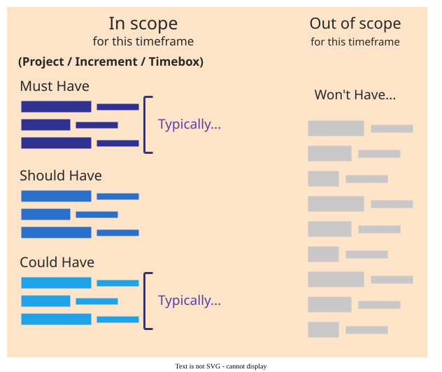
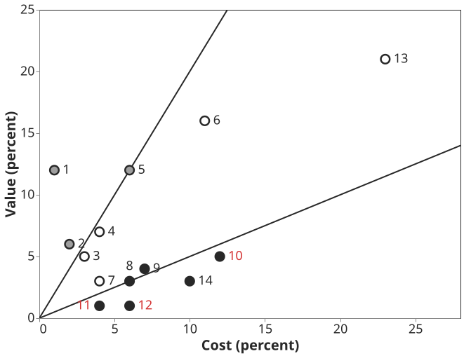

# Prioritising features

**Feature prioritisation** decides what goes into a release first and what waits when not everything
fits. It is two jobs, not one: ranking the candidates, then selecting the subset that the release's
capacity can hold .

## 1. What it is

Release planning behaves like packing a knapsack. Each feature has a value and a cost, the release
has a fixed capacity, and the aim is the most valuable set that fits. The analogy breaks in one
place: features depend on each other, and knapsack items do not.

Three families of technique each handle part of the problem:

- **Categories**, such as MoSCoW, sort a long backlog quickly and build contingency into the plan.
- **Ratios**, such as cost–value with the Analytic Hierarchy Process (AHP), show how unequal the
  features really are.
- **Models**, such as EVOLVE and the Incremental Funding Method (IFM), add dependencies, weighted
  stakeholders, urgency and money, and propose several plans for a person to choose from.

## 2. Categories: MoSCoW

DSDM defines four categories . The **Must Haves** are *"the Minimum Usable
SubseT (MUST) of requirements which the project guarantees to deliver"*. The test is consequence, not
importance: *"If there is some way around it, even if it is a manual and painful workaround, then it
is a Should Have or a Could Have requirement."* A **Should Have** is important but not vital; a
**Could Have** is *"the main pool of contingency"*; a **Won't Have** is agreed not to be delivered
this time. DSDM keeps Must effort at *"no more than 60%"* and Could effort *"around 20%"*, and gives
no figure for the Shoulds. Why 60% works is on [Buffered MoSCoW](moscow).

*DSDM Consortium 2014, Fig. 10a.*

**Example.** For Quill, a fictional word processor, *saving a document* is a Must: nobody would ship
a word processor that cannot save. *Autosave* is a Should, because saving by hand is a painful
workaround. A *grammar checker* is a Could. Autosave may depend on saving, but no Must may depend on
autosave: *"A Must Have cannot depend on the delivery of anything other than a Must Have"*.

## 3. Ratios: cost–value

Karlsson and Ryan have customers compare features in pairs by value and engineers compare them in
pairs by cost. AHP turns the answers into shares of the whole, and a diagram shows which features
give high, medium or low value for their cost . People cannot say
what a feature is worth, but they can say which of two is worth more.

On an Ericsson radio project, 14 requirements took 91 comparisons per criterion and about an hour.
With three of them dropped, *"the software system's value for its customers would be 94 percent of
the possible maximum, while the cost would be reduced to 78 percent of the cost for implementing all
requirements."*

*Karlsson and Ryan 1997, Fig. 4; red labels ours.*

The price is the comparisons: doubling the list quadruples the effort
. And by the authors' own account the method *"takes no account
of interdependencies between requirements"* .

## 4. Models: EVOLVE and IFM

EVOLVE weights the stakeholders, collects each one's urgency and value ranks, respects effort and
precedence constraints per increment, and returns several good plans: *"The emphasis of decision
support is on support, not on actually making the decision"* . IFM
adds money and time: a car-reservation feature is worth $266K if started in the first period and
$145K in the fifth . When a feature ships is part of what it is
worth.

## 5. Choosing a technique

Name the factors your situation needs first, then pick the cheapest technique that covers them
. Categorise a long backlog with MoSCoW. Keep pairwise ratios for the
10–20 high-level decisions that carry the money. A model earns its data cost only when many
stakeholders disagree, dependencies are real and features run to dozens. Whatever the technique, the
client decides on value and the developers advise on cost and risk .
A language-model prototype now produces an AHP ranking in seconds ; it
removes the tedium, not the judgement.

## How solid is this?

- **Where it comes from.** DSDM is a certification handbook; its 60% and 20% are recommendations
  without evidence. Karlsson and Ryan report two small telecom cases with no control group.
- **What is thin.** A review of 73 studies found 49 techniques, whose use in complex real settings
  *"has not been reported yet"* . Of 24 release-planning
  models, four have reports of full-scale industrial use .
- **What is constructed.** EVOLVE's case and IFM's figures are invented projects. The language-model
  result is an unrefereed preprint that never compares its ranking with a human one.

---

### Acknowledgments

This page adapts material from lectures by Eduardo Miranda 
on software project management.

### References



---

{: .highlight }
**Disclaimer:** AI is used for text summarization, polishing and explaining. Authors have verified all facts and claims. In case of an error, feel free to file an issue.
