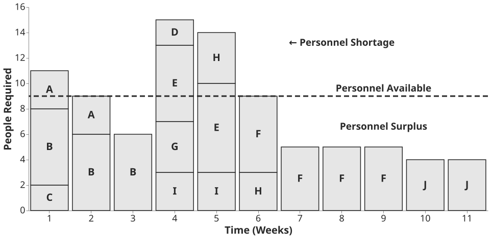
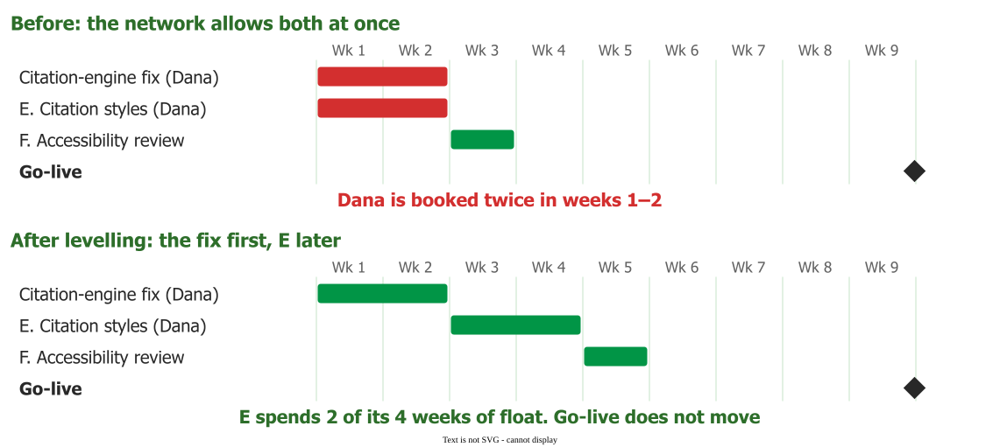

# Resource planning

**Resource planning** fits a schedule to the people who will do the work: how many are needed week by
week, whether anyone is booked beyond their availability, and which tasks move when they are.
**Levelling** is the step that moves them, inside the dates the network allows .

## 1. The resource-use curve

Plot the number of full-time people the plan needs, week by week. The area under the curve is the total
effort, so the curve shows where the estimate peaks. Draw it from real availability, not head-count:
Rubin measures capacity after meetings, other commitments, time off and a buffer, and checks skills as
well as hours . Pressman calls the check **effort validation**: *"no more
than the allocated number of people"* may be scheduled at any moment .

*DSMC 2001, Scheduling Guide for Program Managers, Fig. 6-12* .

## 2. Why the network date is not the delivery date

The [critical path](critical-path) is computed without people: *"Considerations of available manpower
and equipment are conspicuous by their absence."* When its inventors added them, a plan needing 27
mechanics where 8 were available had a critical path about 20% longer . The
network date is what the logic allows; the levelled date is what the team can deliver.

## 3. How levelling works

Levelling has two goals: nobody above 100% of their availability, and a head-count that rises and falls
smoothly. Wysocki offers three strategies :

- **Use float.** Move tasks that have room, free float first so no one else is disturbed, then total
  float. People go to the tasks with least float .
- **Move the finish date** when float runs out.
- **Smooth with limited overtime**, which Wysocki calls *"your final fall-back option"*.

A task can also be split around a person's free days, stretched at a lower share of their time, or given
to a less experienced person if it is not critical. Wysocki's summary: *"It should be obvious to you that
resource leveling almost always stretches the schedule."*

## 4. Example: Dana in the Quill plan

Quill is a fictional word processor nine weeks from going live. For example, Dana owns its ten citation styles, a
two-week task with four weeks of total float. The publisher then asks her to speed up the citation
engine on long documents, part of the critical tuning task. The network sees no conflict; levelling sees
one Dana.

Moving her citation styles later spends float the path already has, so go-live holds, although the
accessibility review behind them slides too. Delaying the tuning work instead would move go-live week
for week. That is the whole levelling decision: the person goes to the critical task, and the other
task spends its float.

## 5. Brooks's law

Adding people is the obvious fix for a late plan. *"Cost does indeed vary as
the product of the number of men and the number of months. Progress does not."* Newcomers must be
trained by the people doing the work, the task must be repartitioned, and communication paths grow as
n(n−1)/2. Hence, *"Oversimplifying outrageously"*: *"Adding manpower to a late software project makes it
later"* .

Twenty years on, Brooks reported Abdel-Hamid and Madnick's softer finding: adding people *"always makes
it more costly, but it does not always cause it to be completed later"*. Add them early, if at all
, and *"be sure that you've assigned them work that is highly
compartmentalized"* .

## 6. When to use it, and where it misleads

Level once the sequence works: order first, people second . Inside a Scrum
sprint the team checks its own capacity instead.

Levelling is a heuristic, and tools disagree: seven commercial packages averaged 4.39% to 9.76% above
the shortest feasible schedule . Once resources shape the longest path, it
runs through people as well as tasks, which is where [critical chain](chain) starts.

## How solid is this?

- **Where it comes from.** Textbooks, the critical-path inventors' report and an essay collection.
  None tests levelling rules on software projects; the package figures are a 1999 benchmark on test
  instances, cited by Herroelen and Leus.
- **What is contested.** Brooks calls his law *"the best zeroth-order approximation to the truth"*, not
  a model.
- **What is ours.** The Quill plan is constructed, and the resource-use curve comes from the lecture,
  not a published source.

---

### Acknowledgments

This page adapts material from lectures by Eduardo Miranda 
on software project management.

### References



---

{: .highlight }
**Disclaimer:** AI is used for text summarization, polishing and explaining. Authors have verified all facts and claims. In case of an error, feel free to file an issue.
