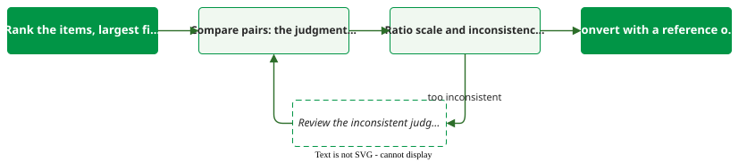

# Paired Comparison

**Paired comparison** sizes a set of items — modules, features, user stories — by judging them two
at a time (*how much bigger is X than Y?*) and deriving one consistent ratio scale from all the
judgments, with an index that flags the judgments that do not fit .
A reference item of known size turns the scale into absolute numbers.

## 1. Why compare instead of size

Over 30 software professionals and graduate students sized eight data structures both ways, and *"the
paired-comparisons method improves both the accuracy and the precision of estimates"*
. The method guarantees consistency, not correctness: *"The
mathematics behind the method are foolproof, but the judgments on which the calculations are based
are not."*

## 2. When to use it, and when not

Use it early, when knowledge is still qualitative, and for items unlike the rest of a backlog —
architecture or infrastructure work that has no comparable story for [Planning Poker](poker). Do not
use it when the judges do not understand the technology being sized, or to compare items more than
ten times apart, *"because our ability to accurately discriminate size diminishes as the difference
between the entities becomes larger."*

## 3. How it works

Miranda's process has five steps :

_Judgments are revised until the matrix is consistent enough; only then are sizes converted._

Each cell of the judgment matrix, aij, says how many times bigger item i is than item j,
with aji = 1/aij. The matrix is perfectly consistent when
aij × ajk = aik. The geometric mean of each row gives the ratio
scale. Three rules keep the judgments sound: choose a reference near the middle of the range, because
*"Entities with sizes in either extreme of the scale tend to amplify any bias that might affect the
judgments"*; keep compared items within 10× of each other; and split a large set among judges, at
most n/3 of them, to reduce single-judge bias.

## 4. Example

For example, an estimator judges four modules, A to D:

| Pair | A/B | A/C | A/D | B/C | B/D | C/D |
|---|---|---|---|---|---|---|
| Judged ratio | 2 | 3 | 4 | 1.5 | 2 | 1.5 |

The geometric means of the matrix rows are A 2.21, B 1.11, C 0.76 and D 0.54. With C as a reference
of 2,000 SLOC, A is about 5,826 SLOC, B 2,913 and D 1,414. The judgments are slightly inconsistent:
A/C × C/D gives 4.5 where A/D was judged 4. The inconsistency index measures exactly that.

## 5. Inconsistency, and how many comparisons

An inconsistency index of 0.35 or less *"would produce satisfactory results in most cases"* for four
or more items — a threshold from Aguarón and Moreno-Jiménez, cited by Miranda, Bourque and Abran
. In their example, correcting one judgment cut the index from 0.94
(±47%) to 0.27 (±14%).

Comparing every pair takes n(n−1)/2 judgments, 45 for ten user stories. An **incomplete cyclic
design** compares each story with r others, n × r / 2 judgments: 20 at r = 4. On ten stories, r = 4
gave a project total of 54.9 points against 44.6 for the full design, while r = 2 — the
triangulation common in agile practice — gave 99.7. Hence: *"comparing one user story to another, or
to two others, is not good enough to produce reliable estimates"* .

## 6. Limitations

People *"tend to become discouraged by the underlying mathematics"*, so keep it behind a spreadsheet.
Several judges can share the comparisons, but the method never reconciles two judges' views of the
same pair. And it cannot remove a bias the judges share: it is consistent *"as long as they are not
biased"* .

## How solid is this?

- **The evidence is the author's own small studies.** The 2001 article calls its results *"not
  conclusive"*; the 2000 paper tested data structures and geometric figures; the 2009 paper checked
  reduced designs against a full design by one senior developer, not against actual effort.
- **The 0.35 threshold** comes from simulations published in operations research, not from software
  data.
- **A probabilistic variant** is cited by Miranda et al. 2009, but its record is unresolved in this
  bibliography, so it is not described here.
- **Using it for architecture items** is a teaching recommendation; the 2009 paper argues for user
  stories.

---

### Acknowledgments

This page adapts material from lectures by Eduardo Miranda and David Root
 on software project management.

### References



---

{: .highlight }
**Disclaimer:** AI is used for text summarization, polishing and explaining. Authors have verified all facts and claims. In case of an error, feel free to file an issue.
