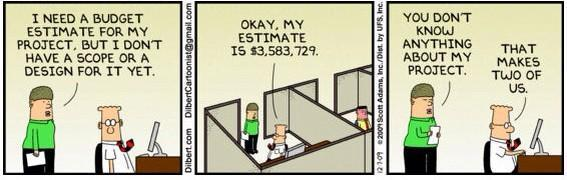
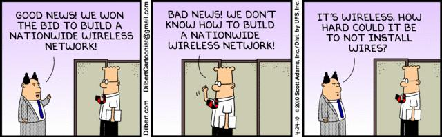
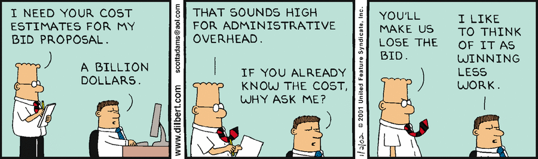
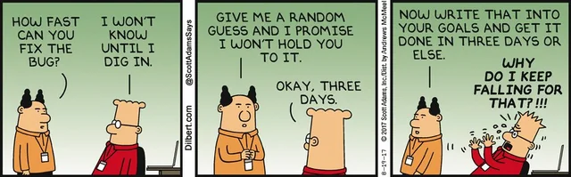

# Scope

This area is about two questions every plan has to answer before it can promise anything: **what
exactly will be delivered**, and **how big is it**. They come in that order, because the second is
asked of the first. A work breakdown structure turns a vague scope into a complete list of
deliverables; estimation then sizes that list and derives effort and schedule from the size. RAND's
review of cost estimating puts the weight where it belongs: the chance that an estimate lands far
from the actual cost *"depends more on accurate size estimates than on any other cost-related
parameter"* .

Two sections follow, in the order a project meets them.

- **[WBS](wbs/)** — how to decompose a project into deliverables so that nothing is missing and
  nothing is counted twice, and which orientation answers which management question.
- **[Estimates](estimates/)** — how to turn that scope into size, effort and schedule: expert
  judgment, group techniques, function points and parametric models, and how to combine them.

The strips below are a reminder of what happens when either step is skipped.

---

### References



---

{: .highlight }
**Disclaimer:** AI is used for text summarization, polishing and explaining. Authors have verified all facts and claims. In case of an error, feel free to file an issue.
