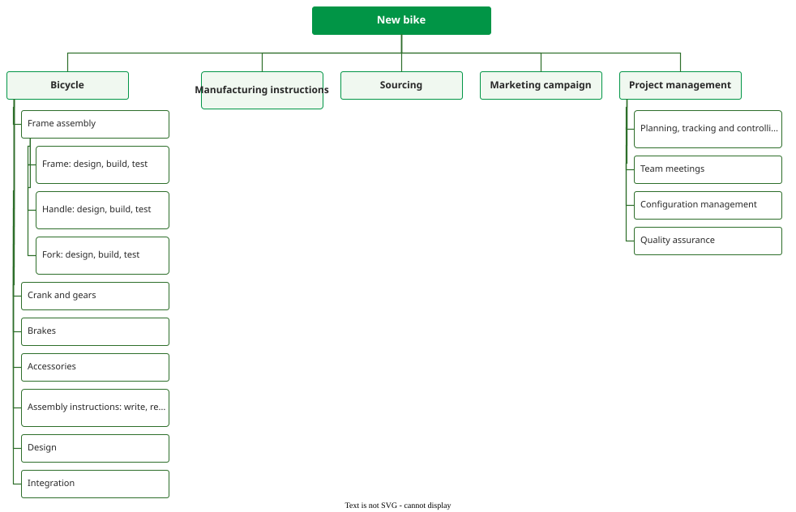

# Building a WBS

Building a WBS means decomposing the project's **outcomes**, and the work that produces them, into
elements that one person can own, estimate and track, while every level holds all the work of its
parent and nothing else.

## 1. What goes in

Outcomes come in four kinds : **products** (software, documents),
**services** (training, data migration), **processes** (an installation procedure) and
**capabilities** (the organisation can operate the new system). Under an outcome sits the work that
realises it. An **activity** is a mixed bundle of tasks with one purpose; a **task** is homogeneous
work. A **work package** is an outcome or activity plus the tasks that realise it, such as *Fork:
Design, Build, Test* below.


_The new-bike WBS._

*Project Management* appears once, at Level 2, because it serves every outcome; *Design* and
*Integration* sit under *Bicycle* because they serve its parts. A tree can also be written as an
outline, and *"Both convey exactly the same information"* . Quill 1.0,
an invented word processor for a publishing house, as an outline:

```text
1      Quill 1.0
1.1    Project management
1.2    Systems engineering: requirements baseline, notional architecture, risk register
1.3    Quality assurance: reviews; accessibility review of the citation dialog
1.4    Editor: styles, tables, comments
1.5    Big-document engine: layout cache; performance test at 500 pages
1.6    Citations: citation library; ten publisher styles; citation dialog
1.7    PDF export: vendor engine (select, learn, set up, adapt, interface); licence
1.8    Cloud sync: sync service; EU data-centre set-up
1.9    Document store: used by 1.4, 1.6 and 1.8, so it sits under none of them
1.10   System integration & test: integration builds; acceptance run at the publisher
1.11   Release: user guide, installer, delivery to the publisher
1.12   Quill 2.0, tracked changes: planning package
```

Elements 1.1 to 1.3 are enabling work, 1.4 to 1.9 the product, 1.10 the integration.

## 2. The 100% rule

PMI's 2001 standard states the rule in parts, not by name : *"Each
WBS element should represent an aggregation of all subordinate WBS elements listed immediately below
it"*, and each element has a single parent. It also prices each failure: *"If necessary work is
omitted, the project will almost certainly be delayed and may experience cost overruns. If
unnecessary work is performed, the customer's time and money will be wasted."*

The "100%" wording is NASA's checklist: *"Does the overall WBS structure include 100% of the project
scope of work?"*, counting project management and systems engineering as scope .
The converse is no double counting. Cost rolls up *"without allocation of a single element of work
scope to two or more WBS elements"* , so a parent equals the sum of its
children only when nothing is missing and nothing appears twice. The WBS dictionary exists for
*"ensuring that all work scope has been identified and to eliminate duplication and overlap"*.

## 3. Where the integrative work goes

The rule is broken by omission. Integration, cutover, data conversion, installation, reviews,
training and meetings are what estimates leave out , so give that work
a branch before anyone estimates. *"Separate WBS elements should be included for integration tasks
where several components are being brought together to create a higher-level WBS element"*
. Work serving several siblings sits beside them; work serving one
element sits under it .

For example, in a clinic-booking app, *Booking* and *Reminders* both send messages through one
notification service. Under both features it is estimated twice; under neither, it is missed.
Beside them, it is counted once, as Quill's document store is.

## 4. When to stop

Wysocki's stopping rule has six criteria : status is measurable, start and
end are clear, completion yields a visible deliverable, the work can be estimated, the duration is
acceptable (he suggests under two calendar weeks), and once started it runs without waiting for
input. *"As soon as every activity in the WBS possesses these six characteristics, the WBS is defined
as complete."* PMI adds: *"Each WBS element must have one person who is clearly accountable for its
completion"*, and warns that *"Excessive WBS levels may require unrealistic levels of maintenance and
reporting"* .

Depth is uneven by design. Far-term work can stop at a **planning package**: *"far-term effort which
can be identified and budgeted in early baseline planning at a higher level, but can not yet be
adequately defined into a WP"* . [Planning waves](waves) shows how it is
decomposed later.

In sequence : write down the scope, choose the Level 2
[orientation](orient), list the outcomes, add integrative and shared architectural elements,
decompose to work packages with a dictionary entry each, tag rather than duplicate, and walk the tree
with stakeholders.

## 5. When the WBS is not enough

A WBS says what, not when. *"Unfortunately, the WBS does not contain scheduling or sequencing
information"* ; the schedule is built from it afterwards. Common faults
are changing the splitting rule within a level, forgetting integration work, copying a shared
component under each feature, and detailing far-term work too early.

## How solid is this?

- **Where it comes from.** Practice standards and textbooks; none tests whether the rule improves
  outcomes.
- **Which edition says what.** The name "100% rule" and the four outcome kinds come from PMI's 2006
  second edition, which this bibliography does not hold. The 2001 edition states only the rule's
  parts; NASA's checklist is the earliest "100%" wording held.
- **Rules of thumb.** Wysocki's two weeks and six criteria are his own. Quill and the clinic app are
  constructed examples.

---

### Acknowledgments

This page adapts material from lectures by Eduardo Miranda and David Root
 on software project management.

### References



---

{: .highlight }
**Disclaimer:** AI is used for text summarization, polishing and explaining. Authors have verified all facts and claims. In case of an error, feel free to file an issue.
