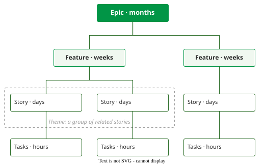

# Work Breakdown Structure

A **work breakdown structure (WBS)** is *"a deliverable-oriented grouping of project elements that
organizes and defines the total work scope of the project"* : the
whole project at the top, each level a finer cut of the level above.

Two rules make the hierarchy useful. The first is NASA's cardinal rule: *"Work scope not contained
in the project WBS should not be considered part of the project"* . The second
is that the WBS has no time axis. *"The WBS is NOT a schedule, and is developed before the project
team develops a timeline for the project"* . A network of tasks says
how and when; the WBS says what, and whose. Without it, *"it is almost impossible to generate a proper
activity network"* .

The shape is a choice. Globerson calls the WBS *"the taxonomy of a project"*: the same work can be
grouped several valid ways, and each grouping implies a different organisation to run it.

## 1. The same idea in agile projects

Scrum teams build the hierarchy with size labels . An **epic** (months,
bigger than a release) splits into **features** (weeks), features into **stories** (days, small
enough for a sprint), and stories into **tasks** (hours). A **theme** is not a level: *"Some teams
also use the term theme to refer to a collection of related stories."* The task layer specifies how
to build rather than what, so the scope hierarchy ends at the story.

_A theme groups related stories; it is not a level of the tree._

## 2. The pages

| Page | The question it answers | Main sources |
|---|---|---|
| [Orientation](orient) | Split the top by deliverable, phase or discipline, and who does each serve? | Globerson, PMI, Wysocki |
| [Building a WBS](building_wbs) | What goes in, how does the 100% rule hold, and when do you stop? | PMI, NASA, Wysocki |
| [Planning waves](waves) | How do you plan work you cannot yet define? | Githens, NASA |
| [NASA](nasa) | How does a product tree carry integration and absorb change? | NASA handbooks |
| [PMI](pmi) | What does the PMI standard require, and what do its own examples show? | PMI 2001 |
| [WBS tools](wbs_tools) | Which software draws and maintains a WBS? | vendor list |

## How solid is this?

- **Where it comes from.** Practice standards, agency handbooks and textbooks. None tests whether
  projects with a WBS do better; the WBS is consensus practice, not a measured result.
- **What is framing.** Rubin never uses the word "WBS". Reading his epic-to-task hierarchy as an
  agile WBS is Miranda's framing , and a useful one.

---

### Acknowledgments

This page adapts material from lectures by Eduardo Miranda and David Root
 on software project management.

### References



---

{: .highlight }
**Disclaimer:** AI is used for text summarization, polishing and explaining. Authors have verified all facts and claims. In case of an error, feel free to file an issue.
