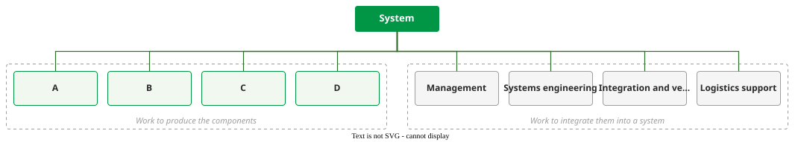
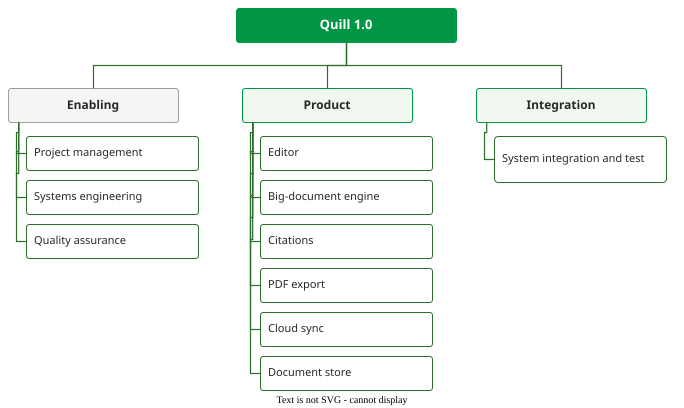

# NASA Work Breakdown Structure

NASA defines a WBS as *"a product-oriented family tree that identifies the hardware, software,
services, and all other deliverables required to achieve an end project objective"*
. Its distinctive rule: the product tree also carries the work of integrating
the products.

## 1. Products plus the work that holds them together

The Systems Engineering Handbook derives the WBS from the product breakdown structure (PBS): *"The
WBS is built, in part, from the PBS by adding, at each branch point of the PBS, any necessary service
elements, such as management, systems engineering, Integration and Verification (I&V), and integrated
logistics support"* . Its figure carries the caption *"The whole takes more
work than the sum of the parts."*

_Product tree plus integration work._

The WBS Handbook turns this into a template (Fig. 3-2). A project WBS, *"while being predominantly
product-oriented, must also reflect all the effort that is in the approved scope of work. Because of
this, common elements of work must be included that are not necessarily product-oriented"*
. Level 2 holds common enabling work (management, systems engineering, safety
and mission assurance), the products, and a systems integration and testing element. Inside each
product the enabling stacks recur *"as necessary"*. So "what goes where" has a definite answer:

| Where | What | In NASA's software example |
|---|---|---|
| Level 2, common | management, systems engineering, assurance, system integration and test | four of the nine Level 2 elements |
| Inside each product | its own design, build and test | *Functional Unit "A"*: Design · Code · Unit Test |
| Nowhere, as a grouping | phases, functions, disciplines, labour categories | *"None are appropriate as WBS elements"* |

## 2. Branch points show how the system is integrated

*"Branch points in the hierarchy should show how the PBS elements are to be integrated"*
. Each branch says: these children are put together here, and the parent's
owner answers for it. NASA's second common error splits the tree one way while the team integrates
another. In a distributed system whose software is integrated with its hardware low down, *"It would
then be inappropriate to separate hardware and software as if they were separate systems to be
integrated at the system level."* The cost: nobody is accountable for that integration, and its cost
cannot be seen. Integrated testing of whole Level 2 systems belongs under Systems Integration and
Testing .

## 3. Fix the top, let the bottom change

*"The top two levels of a project WBS are dictated and controlled by the Agency through standard,
level-two WBS templates"*; levels 3 and below belong to the project , and cost
history stays comparable across projects. Product orientation makes change local: *"If
there is a schedule slip in one element of a WBS, an observer can determine which other WBS elements
are most likely to be affected"* .

## 4. Example: add a function, and one branch grows

NASA's sample software WBS (Fig. 3-10, *Software Project XYZ*) has nine Level 2 elements: Project
Management, Systems Engineering, Safety & Mission Assurance, Systems/Modules Development, Sys
Software Integration & Test, Security Validation, System Deployment, Operational Site Implementation,
and Outreach & Education . Under development sit *Functional Unit "A"* and
*"B"*. Add a third unit:

| What changes | Where | Kind of change |
|---|---|---|
| *Functional Unit "C"*: Design · Code · Unit Test | new Level 3 under development | one new branch, carrying its own cost |
| testing C together with A and B | Sys Software Integration & Test | existing element grows |
| C's pages in the user manuals, help-desk scripts | System Deployment | existing element grows |
| training on C | existing training elements | existing element grows |
| the nine Level 2 elements | — | unchanged |

The new function's cost reads off a few named lines; the structure stays. In a
phase-organised tree the change spreads across every phase, its cost hidden.

The same blocks fit Quill 1.0, an invented word processor:

_A new feature grows only the product branch._

## 5. When to use it, and its limits

The approach suits contracted, multi-organisation work, and any team that wants comparable estimates
across projects: fix Level 2 first, and put each change at the lowest level that holds it. Much of the
handbook is NASA plumbing (a
seven-level finance limit, coding and approval chains); borrow the structure, not the bureaucracy. The
current edition is NASA/SP-3404 (2019), its core text unchanged since 2010 .

## How solid is this?

- **Where it comes from.** Agency handbooks, silent on whether the practice works. The IT template
  is still marked DRAFT.
- **Whose label.** "Hybrid" is not NASA's word; the handbooks have no hit for it. It is the teaching
  label in Miranda's material  for what NASA calls "predominantly
  product-oriented" plus "common elements of work".
- **What is our inference.** The add-a-function example chains four quoted rules; the handbook
  never states the chain itself. Quill is a constructed example.

---

### Acknowledgments

This page adapts material from lectures by Eduardo Miranda and David Root
 on software project management.

### References



---

{: .highlight }
**Disclaimer:** AI is used for text summarization, polishing and explaining. Authors have verified all facts and claims. In case of an error, feel free to file an issue.
