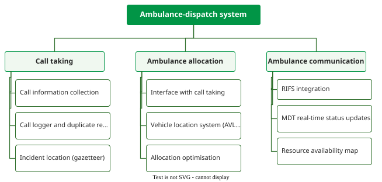
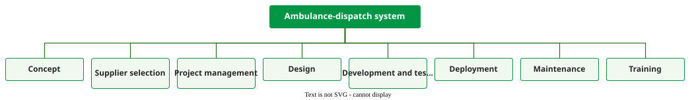

# WBS Orientation

A WBS's **orientation** is the criterion used to split the work at its top levels: by deliverable,
by phase, by discipline, by location or by account. The leaves stay the same whichever is chosen.
What changes is which questions the tree answers at a glance, and who owns what.

## 1. One project, several valid trees

Globerson calls the WBS *"the taxonomy of a project"*: *"Several possible patterns of WBS can be
generated, despite the fact that all of them describe the same project"*
. His running case, five restaurants opened on five campuses, is
drawn by location, function, subsystem, logistics and timing, and each tree is valid. The
[100% rule](building_wbs) fixes the work packages at the bottom; orientation decides how they are
grouped above.

Miranda distinguishes five orientations : **outcome** (deliverable or
product), seen from the sponsor's side; **task** (phase); **discipline** (the skill or department);
**accounting** (the chart of accounts); and **hybrid**, a combination applied consistently. Wysocki
groups the choices into noun-type, verb-type and organisational families, and dismisses the last:
*"These approaches offer no real advantages and tend to create more problems than they solve"*
.

## 2. Example: one ambulance-dispatch system, two WBSs

An ambulance-dispatch system, the software that takes emergency calls and sends ambulances, can be
broken down two ways
. The product-oriented tree splits it into call taking, ambulance
allocation and ambulance communication:

_Product-oriented: every branch is something the sponsor will receive._

The task-oriented tree splits the same project by how it will be executed:

_The same project, split by phase._

A sponsor reads the second as *you know how to do your job*, and the first as *you understand the
scope of my project*. Now drop *Ambulance Communication* from scope. In the product tree, one branch
and its cost disappear. In the task tree, someone must search *Design*, *Development & Testing*,
*Deployment* and *Training* for the fraction of each that served it, and estimate that fraction.

PMI states the risk: *"WBS elements that are not deliverable-focused may lead to project failure"*
. NASA adds accountability: *"The WBS describes functions, not
products. This makes the project manager the only one formally responsible for products"*
.

## 3. The case for verbs

Wysocki argues the other side, for reporting . Under a noun-type top,
every deliverable's summary bar on a Gantt chart runs from design to final test: *"Showing all of
them on a summary Gantt chart would simply look like the stripes on a prison uniform."* Progress is
measured on work, so *"the WBS activities at the lowest levels of granularity must always be
expressed in verb form."*

The two positions concern different levels of the tree. Sponsors, change and accountability need
deliverables at the top; progress needs activities at the bottom. The hybrid takes both: **nouns down
to the work package, verbs inside it.** An outcome may contain activities; an activity may not
contain outcomes . Even PMI's standard is deliverable-*led*, not
deliverable-*only*: its drafting team argued over whether activities belonged in the WBS at all
 (see [PMI](pmi)).

## 4. The shape of the WBS becomes the shape of the organisation

Every node needs an owner, so the grouping decides who reports to whom. Globerson's exhibit is an MBA
curriculum with one work package per course . In a flat WBS, **30**
course packages report directly to the project manager. Grouped by discipline into three levels, the
same 30 courses sit under **six** group managers. *"Very few managers are sufficiently qualified to
run a project with such a flat WBS."* A mismatch between the WBS, the organisation and the manager's
style *"has a negative impact on the likelihood of the project being completed successfully"*, and
the WBS designer fixes it *"at the very early stage of proposal submission, sometimes without being
aware of it."*

## 5. When to choose deliberately

Choose deliberately when the WBS will be read by a sponsor, carved into contracts or staffed by
several departments. Put the dimension asked about most often in the tree and tag the others onto the
work packages. Coding allows regrouping later, but *"the orientation of the original chart is of great
importance to its users"* . On a small single-team project, the choice matters far less.

## How solid is this?

- **Where it comes from.** Globerson argues from constructed examples and reports no data; he calls
  for further studies. PMI and NASA are practice standards, Wysocki a consultant's textbook.
- **What is contested.** Globerson accepts a function-oriented WBS for a centralising manager; NASA
  calls functions and organisations inappropriate as WBS elements .
- **What we do not hold.** Rad (1999) on deliverable-oriented WBSs is not in this bibliography, so
  nothing here rests on it. The ambulance-dispatch trees are Miranda's teaching constructions, not project records.

---

### Acknowledgments

This page adapts material from lectures by Eduardo Miranda and David Root
 on software project management.

### References



---

{: .highlight }
**Disclaimer:** AI is used for text summarization, polishing and explaining. Authors have verified all facts and claims. In case of an error, feel free to file an issue.
