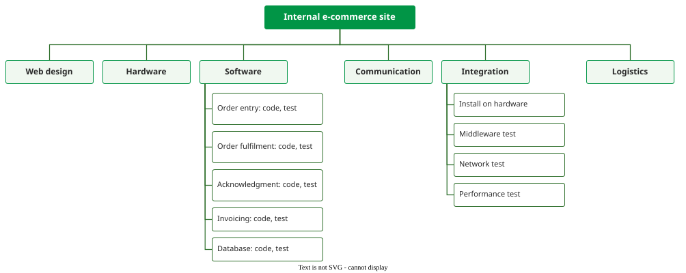

# PMI Practice Standard for Work Breakdown Structures

PMI's first *Practice Standard for Work Breakdown Structures* (2001) adopts the PMBOK Guide 2000
definition: *"A deliverable-oriented grouping of project elements that organizes and defines the
total work scope of the project. Each descending level represents an increasingly detailed definition
of the project work"* .

## 1. Why use one

The standard derives two goals from scope management: *"To ensure that the project includes all the
work needed."* and *"To ensure that the project includes no unnecessary work."* Together they are the
[100% rule](building_wbs) in all but name. The WBS then feeds activity definition, resource planning,
cost estimating, cost budgeting and risk planning. Skipping it is a named risk: *"Omitting WBS
development and proceeding directly to the network diagram (such as a Gantt chart, CPM Schedule, or
Precedence Diagram) may lead to unforeseen and unexpected difficulty, including project delay."* Its
metaphor: *"The WBS is the technique for dividing “the elephant” into bite-sized pieces."*

## 2. How to build one

The standard gives four steps: identify the final products from the statement of work and the
requirements; define the major deliverables, including predecessors such as a design specification;
decompose to the level needed for management and control; and review and refine until stakeholders
agree that planning can be completed. Three structural rules apply throughout:

- *"Each WBS element should represent an aggregation of all subordinate WBS elements listed
  immediately below it."*
- *"Each WBS element must have one person who is clearly accountable for its completion."*
- *"Separate WBS elements should be included for integration tasks where several components are
  being brought together to create a higher-level WBS element."*

How deep to go is set by fifteen "decompose further?" questions, such as whether a finer split would
improve estimates, or whether an element hides more than one owner or deliverable. Go at least one
level below the reporting requirement, but *"Excessive WBS levels may require unrealistic levels of
maintenance and reporting."* Rolling wave planning gets one sentence (see [Planning waves](waves)).

## 3. Deliverable-led, not deliverable-only

The standard warns that *"WBS elements that are not deliverable-focused may lead to project
failure"*, naming a WBS structured strictly by process or organisation. The same section still asks
for elements for opening and closing stages such as planning and testing, and for project management
as level-of-effort work. Its drafting team split over the point: *"a controversy developed within the
project team on whether or not an activity was or should be part of the WBS"*. The
[Orientation](orient) page takes up both sides.

## 4. Example: two software WBSs in one standard

*"Eleven WBS examples were approved and incorporated as Appendices E through O of this Practice
Standard"* , from offshore oil platforms to telecom and government design-bid-build. Two are software.

Appendix K, *Web Design*, builds an internal e-commerce site and is deliverable-led. Features each
split into code and test, and integration has its own branch, as the standard requires:

_Deliverable-led, with integration as a branch of its own._

Appendix O, *Software Implementation*, is phase-led: Project Management, Product Requirements, Detail
Software Design, System Construction, Integration & Test, with leaves such as "Create Draft Software
Requirements". It reads as a lifecycle, the shape the standard's own warning targets. Appendix K
has the opposite gap: no project-management branch, although the standard asks for one. The standard
itself cautions that *"None of the examples should be taken as the only right WBS for that type of
project."*

## 5. When to use it, and its limits

Use the standard for plan-driven, contracted projects where scope must be agreed and traced. It says
nothing about iterative or agile delivery beyond one rolling-wave sentence. It is also the first of
three editions: the second (2006) names the 100% rule and the outcome types that much teaching
material cites, and the third appeared in 2019.

## How solid is this?

- **Where it comes from.** A volunteer-drafted consensus standard, with 488 public review comments,
  citing only five references. It records accepted practice, not evidence that the practice works.
- **What we do not hold.** The 2006 and 2019 editions. Rules worded in those editions, including the
  name "100% rule", are not attributed to this one.

---

### Acknowledgments

This page adapts material from lectures by Eduardo Miranda and David Root
 on software project management.

### References



---

{: .highlight }
**Disclaimer:** AI is used for text summarization, polishing and explaining. Authors have verified all facts and claims. In case of an error, feel free to file an issue.
