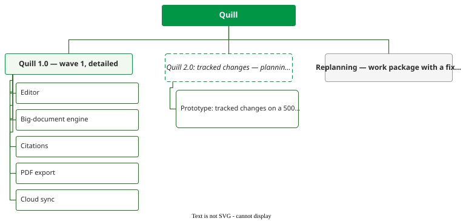

# Planning Waves

**Rolling wave planning** keeps the top of the WBS complete from the first day and details only the
next horizon: *"the plan is detailed for the immediately upcoming work only and work far in the
future is defined at a high level until later in the project life cycle"*
.

## 1. Detail where you can see

Githens states the core: *"A core premise of RWPP is the use of
time-phased structure at the high level of the WBS. At the end of each phase, the team develops the
work for the next phase"* .

Visibility comes from **completeness at the top**: every deliverable is in the tree with a budget,
so the [100% rule](building_wbs) always holds. Flexibility comes from **deferring detail at the
bottom**. The tree is lopsided by design, deep where the team knows enough and shallow elsewhere.

## 2. Work packages and planning packages

NASA names the two kinds of leaf: *"A WP provides further detail on work content that is considered
near-term, while a PP defines far-term work at a summary level"* .

| | Work package | Planning package |
|---|---|---|
| Horizon | the current wave | a later wave |
| Detail | decomposed into tasks | one summary element |
| Estimate | bottom-up | top-down, from what is known now |
| Next step | executed and tracked | decomposed at the next replanning |

The budget makes a planning package more than a placeholder; without it the estimate has a
hole.

## 3. Running the waves

Githens gives seven steps. Check that the development strategy suits rolling wave; set the time
buckets, meaning how many horizons and how long; give every horizon a high-level estimate, and *"Do
not drill down to details or attempt bottom up estimating"*; detail the first wave bottom-up;
baseline with the sponsors; execute; then assess what was learned and replan the next horizon. *"The
work scope baseline (WBS) is modified to reflect the added detail."*

How long is a wave? Githens answers with a boat crossing an unknown sea: with the horizon twenty miles
off and the crossing ninety to a hundred and ten, you reset the course at least five times. A wave is
as long as you can see ahead.

## 4. The replanning is a work package

Rolling wave fails predictably: the replanning does not happen. Githens's defence is to
*"Establish a work package and fixed date for replanning"*, triggered by a date, a deliverable or a
percent complete. *"The deliverable of the replanning work package is an updated RWPP plan."* It
costs several hours to several days. Skipped, it gives way to *"code-like-hell"* practices.

Each wave changes the WBS, so keep it under configuration management with stable element codes
; wave 1's costs must still roll up in wave 4.

## 5. Example: Quill 1.0 and 2.0

Quill is an invented word processor for a publishing house. The first wave details its 1.0 branches
into work packages. The customer has already asked for tracked changes in Quill 2.0; that stays one
planning package with a purpose, an owner, a summary budget and a tentative date, but no tasks. The
sponsor sees the whole scope and cost; nobody decomposes work that depends on how 1.0 turns out.

_Detail the next wave; hold the rest as a planning package._

Tracked changes is also risky, because a 500-page document must still open within 2 seconds. So the
first wave adds one work package, a prototype on a 500-page document, whose deliverable is the
knowledge needed to decompose the package at the next replanning. Do not detail the guess; schedule
the learning. A Scrum backlog is *detailed appropriately* in the same way, its large items split just
in time .

## 6. When not to use it

Githens lists four assumptions behind linear planning : problems are
solved by splitting them, planning and doing are separate, the future is predictable, and projects are
simple. On compact, well-defined, modular work they hold: plan up front, because rolling wave only
adds replanning overhead. Where they fail, roll: *"You can't schedule a technological
breakthrough."* The price is discomfort, as teams manage precise and imprecise data at once.

## How solid is this?

- **Where it comes from.** Githens is a consultant's conference paper. Its only data is an informal
  poll of practitioners, and the method is not evaluated. Cite it for what rolling wave is and how to
  run it, not as evidence that it improves outcomes.
- **Where the terms come from.** "Planning package" is NASA's earned-value vocabulary; it does not
  occur in Githens or in PMI 2001. Rubin never says "rolling wave"; the link to his backlog rule is
  ours.
- **What is illustrative.** "At least five times" is the boat analogy's arithmetic, not a measured
  rate. Quill is a constructed example.

---

### Acknowledgments

This page adapts material from lectures by Eduardo Miranda and David Root
 on software project management.

### References



---

{: .highlight }
**Disclaimer:** AI is used for text summarization, polishing and explaining. Authors have verified all facts and claims. In case of an error, feel free to file an issue.
