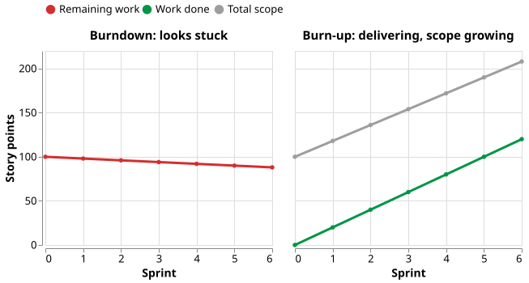

# Burndown and burn-up charts

A burndown chart plots the work still remaining against time: its slope shows how fast the team is
finishing, and extending the line to zero gives a forecast . A burn-up
chart shows the same progress climbing, with total scope drawn as a separate line.

Use either for work delivered in short iterations and sized in points or hours. Neither fits a
fixed-date release with open scope: both *"assume you know how much total scope you have to burn down
or burn up"* .

## 1. Two burndowns answer two questions

The **iteration (sprint) burndown** is summed daily from the task board. The **release burndown** is
updated once per sprint. Most misreadings come from mixing them up.

| | Iteration burndown | Release burndown |
|---|---|---|
| **Unit** | effort-hours or tasks | story points on backlog items |
| **Cadence** | daily | once per sprint |
| **Who reads it** | the development team | product owner, stakeholders, management |
| **Question** | will we finish this sprint's commitment? | when will the release be done, and with what? |

The iteration burndown steers the team. The release burndown forecasts: its drop over a sprint is
that sprint's velocity, and its trend gives a date, best quoted as a range (see
[Velocity and flow](agile.md)).

## 2. Reading "actual above the ideal line"

The ideal line runs straight from the starting total to zero at the end. When the actual line sits
above it, more work remains than the plan expected. **The chart does not say why.**

On a sprint burndown, a rise is often an estimate getting better. In Rubin's example sprint, remaining
work went from 180 to 190 effort-hours on day 3 because one task was re-estimated from 8 to 16 hours
. Nobody slowed down; the task board shows whether tasks grew or nothing
finished.

On a release burndown, a flat line has two causes that draw the same picture: the team finished less,
or scope was added as fast as the team finished it. They call for opposite responses. A slow team
needs its impediment found. Growing scope is the product owner's call, to cut scope or move the date;
pushing or enlarging the team makes it worse.

## 3. The burn-up separates the causes

A burn-up chart draws **work done** and **total scope** as two lines. *"Some people prefer to use the
burnup format because it can easily show a change in scope for the release"*: when scope is added,
the target line moves up in the sprint where it arrived . Slow work
flattens the done line; added scope lifts the target.

_An illustration, not real data: a made-up team finishes 20 points a sprint while 18 are added. The
burndown creeps from 100 to 88; the burn-up shows 120 points done against scope rising from 100 to 208._

A burndown can do the same if the line is stepped up where scope is added
.

## 4. Example: a newspaper site that looked stuck

Slovenia's largest publisher rebuilt its daily newspaper's website in 2011, in nine three-week sprints
with six to eight people. By sprint 7 the release burndown sat far above ideal. Yet the team had
completed **about 155 points** in six sprints, while remaining work fell only **from about 64 to about
52**. The reason: *"emerging requirements, which were not part of the initial Product Backlog, but were
constantly added by the Product Owner during the project"* .

Read alone, the chart said the team had done almost nothing; its velocity said it delivered steadily
while scope more than doubled. The company used the burndown to simulate cuts and
*"successfully launched a reduced release after 9 Sprints"*, against seven expected. When it did add
two developers, in sprint 5, velocity fell to about 8 against 39 planned. **Before you push the team,
check whether the target moved.**

## 5. What a burndown does not show

A burndown holds estimates of what remains and nothing else: *"The sprint backlog and the sprint
burndown charts always use estimated effort remaining. They do not capture actual effort expended"*
. So it cannot show cost; a budget owner needs a different instrument
(see [Choosing a tracking instrument](choosing.md)). Nor does it show value or quality.

## How solid is this?

- **Where it comes from.** The definitions and constructed examples are from one practitioner
  textbook ; the only real project is the newspaper site, measured by its
  own coach.
- **What is contested.** Little about the mechanics. The newspaper figures are read off the paper's
  charts to about two points, and "more than doubled" is our arithmetic, hence "about".
- **What we do not hold.** No study shows that teams using burn-ups deliver better. The argument for
  the burn-up is that it shows something the burndown hides, not that it improves outcomes.

---

### Acknowledgments

This page adapts material from lectures by Eduardo Miranda and David Root
 on software project management.

### References



---

{: .highlight }
**Disclaimer:** AI is used for text summarization, polishing and explaining. Authors have verified all facts and claims. In case of an error, feel free to file an issue.
