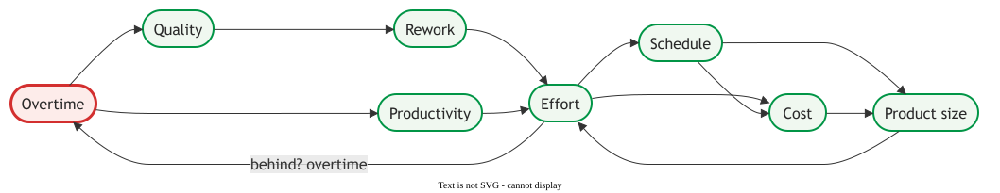

# Controlling a project

Controlling a project is doing something about what the [progress report](report.md) shows:
*"Controls are actions taken as a result of reports"* . It decides
which variance gets action, which action, and when a project should stop.

## 1. Set the threshold before the number arrives

A line agreed at the start stops *"we'll catch up next period"* from winning. A **magnitude**
line catches a large gap: Wysocki treats a 10% cost variance as *"the most allowed"*
, and a construction convention puts Green under 3% impact on
schedule or cost, Yellow at 3–5% and Red above 5% . A **trend** line, such
as a milestone slipping report after report, fires earlier, and early matters: cumulative CPI
settles by about 20% complete .

Crossing a line starts an analysis, not an action: *"the conditions must be analyzed to identify why
the variance exists"* . A slow team and a growing scope draw the same late
number and need opposite responses.

## 2. Every corrective action spends something

_Overtime is the lever._

Overtime gives a short gain, then *"an aggressive decline in velocity along with a simultaneous
decline in quality"* , and the rework flows back into schedule and
cost. **Overtime buys a week now and rework later.** Adding people has the same
shape: *"Adding manpower to a late software project makes it later"*
.

Wysocki orders the alternatives by who pays, cheapest first :

1. Leave the slip alone if the task has float.
2. Overlap tasks planned end to end.
3. Reassign people from non-critical work.
4. Ask resource managers for more.
5. Offer the customer the key features on the date, the rest later.
6. Ask for more time, which *"offers the customer nothing in trade."*

For example, a word processor's export module is a week behind on the critical path; the
spell-checker is behind too, but has float, so it is left alone. The team overlaps export's
file-format and UI work, borrows a spell-checker developer, and if that fails ships two export
formats on the date. Nobody works weekends.

## 3. Predictive and agile control steer different things

Both run a feedback loop, but they let different variables move.

| | Predictive control | Agile control |
|---|---|---|
| **Held fixed** | scope, the baseline | the time box: date, budget, team |
| **Steered** | cost and schedule, back to the baseline | scope, by reordering the backlog |
| **Where** | variance review, weekly or monthly | sprint review; daily scrum |

On one newspaper site the release burndown sat far above ideal; the company simulated cuts and
*"successfully launched a reduced release after 9 Sprints"* . Before
acting on a stalled [burndown](burndown.md), ask whether the team slowed or the target moved.

## 4. Stopping a failing project

Here **escalation** means raising a problem to someone who can fix it; Wysocki's six steps are the
*escalation ladder*, and **escalation of commitment**, never shortened, is continuing a failing
course despite negative information .

CONFIG, a sales-configuration expert system, was funded for more than a decade while its
usage fell from about 2.3% of quotations to about 0.1% . One manager
wrote three whistle-blowing memos; a sales rep said *"The problem is nobody is willing to kill it."*
It ended when its champion died: nobody had written down what failure looked like.

A stop rule is a threshold on what the project is for, set before anyone is attached. Keil's
outsider question: *"If I took over this job for the first time today and found this project
going on, would I support it or get rid of it?"* Escalate the problem early, so nobody escalates
the commitment later.

## 5. When measurement bites back

A number used to judge a team moves toward its target. Bouwers et al. name four failures: a metric
without context, changes made only to move a metric, one metric alone, and too many to read
; see [Process metrics](../proc/basics/metrics.md) and
[Velocity and flow](agile.md). DeMarco grants his *"You can't control what you can't measure"* a
*"real truth"*, but *"strict control is something that matters a lot on relatively useless projects
and much less on useful projects"* .

## 6. When to use it, and when not

Set thresholds and a stop rule at the start of any project with a budget or a committed date,
tightest where the value margin is thin. Where it is wide, keep control light.

## How solid is this?

- **Where it comes from.** Thresholds are rules of thumb from a textbook, space flight and
  construction; none shows that its value is right.
- **What is contested.** Brooks calls his law *"Oversimplifying outrageously"*. The loop is lecture
  material; its signs are our reading.
- **What we do not hold.** Evidence that thresholds, the ladder or stop rules improve outcomes.
  Stopping rests on one case.

---

### Acknowledgments

This page adapts material from lectures by Eduardo Miranda and David Root
 on software project management, including the
control loop.

### References



---

{: .highlight }
**Disclaimer:** AI is used for text summarization, polishing and explaining. Authors have verified all facts and claims. In case of an error, feel free to file an issue.
