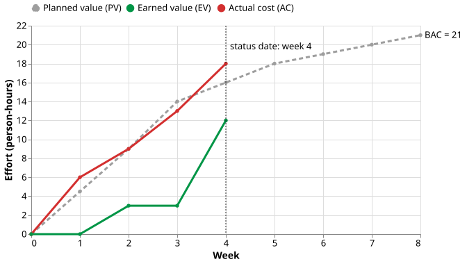
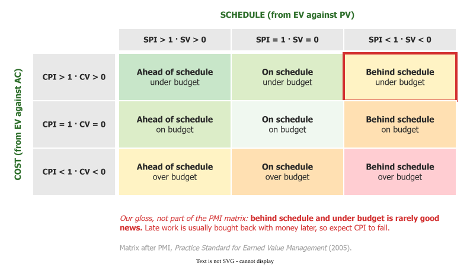

# Earned value

Earned value (EV) is the budget of the work actually finished by a given date. Set beside the plan
and the actual spend, it shows how much of the planned work is done and what that work cost
.

## 1. Three numbers

Earned value management tracks three curves, in money or in person-hours, the unit a software team
plans in . **Planned value** (PV, or
BCWS) is the budget of the work scheduled to be done by now. **Earned value** (EV, or BCWP) is the
budget of the work actually finished by now. **Actual cost** (AC, or ACWP) is what the finished work
cost.

| Measure | Formula | Below the line means |
|---|---|---|
| Schedule variance (SV) | EV − PV | below 0: less work done than planned |
| Cost variance (CV) | EV − AC | below 0: the work cost more than its budget |
| Schedule performance index (SPI) | EV / PV | below 1: behind schedule |
| Cost performance index (CPI) | EV / AC | below 1: over budget |

## 2. The spend curve is not progress

Comparing PV with AC compares two spending curves, which is *"an indicator only of spending and not
of overall project performance"* . Money not spent is usually work not
done . Only EV shows the work.

_Six tasks, 21 person-hours over eight weeks, read at week 4._

In this eight-week example, by week 4 the plan called for 16 hours of work (PV), the finished tasks
were budgeted at 12 (EV), and the team had spent 18 (AC). EV below PV says the project is behind; AC
above EV says the finished work cost more than its budget. Read PV against AC alone and the project
looks merely a little over plan.

## 3. Read the two indices together

The matrix names today's cell; a manager needs next month's. **Behind schedule and under budget is a
cost warning, not a saving**: *"because schedule problems are often resolved by additional spending,
an adverse SPI is also predictive of later cost problems"* . In one
project Lipke charts, CPI stayed above 1.1 for four months while SPI sat near 0.8, then fell below 1
and finished near 0.7 .

For example, in a software textbook exercise 12 tasks are done where the schedule says 15, giving SPI
0.81 and CPI 0.99 . The finished tasks cost their estimate, so the team
is not slow: it is short of people or started late, and the fix is staffing, not pressure. An SPI
above 1 can mislead too, if the extra work is off the critical path . Act
early: cumulative CPI settles by about 20% complete and rarely improves .

## 4. Value is earned by a rule

EV is a calculation stacked on a judgement of how much is done, so the earning rule is fixed before
work starts . Under **0/100** a task earns its budget only
when finished; under **50/50**, half at the start and half at the finish. Neither can be talked up.
Self-reported **percent complete** can, and it carries the [90% syndrome](report.md) straight into
EV. Calculate it from finished tasks instead , and keep the baseline
still, because a reset moves every index with nothing going faster.

## 5. SPI drifts to 1.0 on a late project

SV and SPI are measured in money, not time. When a late project finishes, all its planned value has
been earned, so SV returns to 0 and SPI to 1.0 whatever the delay; the schedule indices say little in
the final third . Lipke's **earned schedule** fixes this: find the date
by which the plan expected today's EV, and read the gap in months.

## 6. When to use it, and when not

Use earned value when someone owns a budget and the work is planned as estimated, scheduled tasks
against a stable baseline. Without that plan, EV adds paperwork: most of the reasons Lukas gives for
EVM failing are planning failures . A team without budget responsibility
may learn as much from a burndown; see [Choosing a tracking instrument](choosing.md).

## How solid is this?

- **Where it comes from.** The definitions are standard. The only software EV number here is a
  textbook exercise, and the eight-week example is lecture material.
- **What is contested.** That behind-and-under predicts an overrun is a mechanism plus one chart read
  off a plot, not a measured rate. The 20% result is an earlier defence-contract study (Christensen
  and Heise, 1993) that Christensen reports, and he argues for EVM.
- **What we do not hold.** Evidence that EVM improves outcomes, that earned schedule is validated, or
  that 0/100 earning cures the 90% syndrome: a finished task can still come back as rework.

---

### Acknowledgments

This page adapts material from lectures by Eduardo Miranda and David Root
 on software project management, including the
eight-week example.

### References



---

{: .highlight }
**Disclaimer:** AI is used for text summarization, polishing and explaining. Authors have verified all facts and claims. In case of an error, feel free to file an issue.
