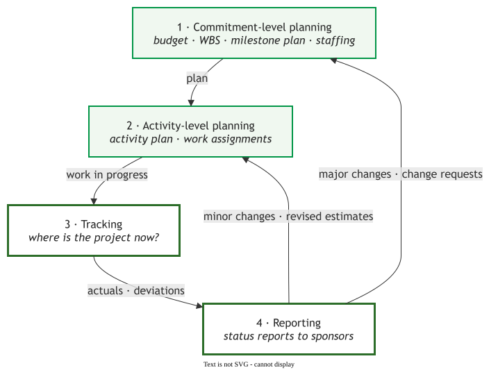

# Tracking

Tracking is determining where the project is, so that reporting and control have facts to act on.

Planning commits a project to a budget, milestones and staffing, then breaks that commitment into
activities. Tracking measures the work in progress against the plan, and reporting carries the
actuals and deviations to the people who fund the project. Small deviations return as revised
estimates; large ones return as change requests against the commitment. Control is what turns a
deviation into an action.

The six pages follow that loop: how to report, how to act, and which instrument to read.

| Page | What it answers |
|---|---|
| [Reporting progress](report.md) | How do we tell sponsors where we stand, and why does "90% done" last so long? |
| [Controlling a project](control.md) | Which variance needs action, which action, and when should a project stop? |
| [Earned value](evm.md) | How much of the planned work is done, and what did it cost? |
| [Burndown and burn-up charts](burndown.md) | How much work remains, and did the team slow or the scope grow? |
| [Velocity and flow](agile.md) | When will the release be done, and where is work waiting? |
| [Choosing a tracking instrument](choosing.md) | Which chart fits this project and its reader? |

---

### Acknowledgments

This page adapts material from lectures by Eduardo Miranda and David Root
 on software project management.

### References



---

{: .highlight }
**Disclaimer:** AI is used for text summarization, polishing and explaining. Authors have verified all facts and claims. In case of an error, feel free to file an issue.
